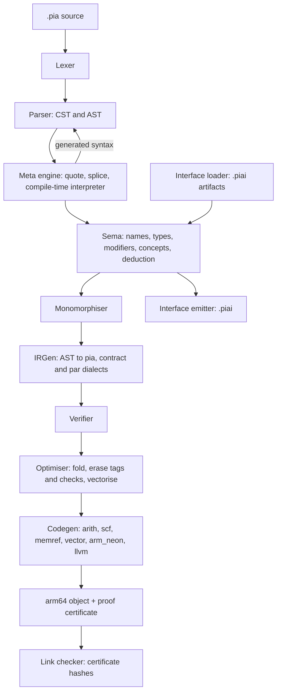

# Pia compiler architecture

Status: proposed, 2026-11-20. This breaks the design in [`design.md`](design.md) into compiler components and MLIR dialects. The dialect layering is recorded in [ADR 0018](adr/0018-dialect-layering.md).

## Components

| Component | Responsibility | Built on |
| --- | --- | --- |
| Lexer, parser | Tokens, concrete syntax tree, AST with source locations | Hand-written C++ (recursive descent with Pratt parsing for operators) |
| Meta engine | Quote and splice, compile-time evaluation of `let meta`, the expansion loop to a fixed point, `--meta-cycles` | A tree-walking interpreter over the AST first; JIT later if needed |
| Sema | Name resolution, type checking, parameter modifiers and ownership, concept checks, type argument deduction | C++ over the AST |
| Monomorphiser | Instantiates generics so every later stage sees concrete types | C++ over the AST |
| IRGen | Lowers the typed AST to Pia's MLIR dialects | MLIR builders |
| Verifier | Turns contracts and implicit obligations (bounds, overflow, `out` fully written, exhaustiveness) into proofs. See below | MLIR dataflow framework, `smt` dialect, Z3 |
| Optimiser | Uses proved facts to drop checks, erase `dyn` tags, fold constants and vectorise | MLIR canonicalisation and custom passes |
| Codegen | Lowers to standard dialects and then LLVM for arm64 | Upstream MLIR conversions |
| Interfaces and certificates | Emits `.piai` interface artifacts, records interface hashes in each object, refuses mismatched links | Small C++ library plus a Bazel rule |
| Runtime | Concurrency (`par_for`, collectives, later task graphs and futures) | C++ runtime library linked into Pia programs |
| Standard library | Prelude (operators, `vec`, core concepts), `Image.Png`, `Image.Gif` | Written in Pia once the compiler can build it |

## Dialects

Pia has three of its own dialects and reuses upstream dialects for everything else.

| Dialect | Holds | Lifetime |
| --- | --- | --- |
| `pia` | Pia's types and values: range-typed integers (`!pia.int<lo, hi>`), fixed arrays and slices with lengths, structs, `dyn` with its tag set, functions with parameter modifiers as attributes | IRGen to codegen |
| `pia.contract` | `requires`, `ensures`, `invariant`, `decreases`, `assert`, `assume`, `old`, quantifiers (`forall`, `exists`), and an `obligation` op that ties each proof goal to a source location | IRGen to the end of verification, then erased |
| `pia.par` | Tiled grids with halos, `par_for`, collectives (`halo_exchange`, `all_reduce`, `scatter`, `gather`), placement attributes | IRGen to runtime lowering |
| `smt` (upstream) | Solver terms: bit-vectors, booleans, arrays, quantifiers, solver and assert ops | Built by the verifier, exported to SMT-LIB for Z3 |
| `arith`, `scf`, `memref`, `vector`, `linalg`, `arm_neon`, `llvm` (upstream) | Codegen targets | After verification |

Design points:

- Contracts are ops in their own dialect, not attributes, so they can reference SSA values and be verified, transformed and erased by ordinary passes.
- Proved facts survive verification as attributes on the ops they justify (for example `pia.proved = ["inbounds", "nooverflow"]`), so the optimiser can act on them after contracts are erased.
- Implicit obligations (index in bounds, no overflow under `@overflow(proof)`, exhaustive `match`) are materialised as `pia.contract.obligation` ops by a single pass, so the verifier has one kind of goal to handle.

## Verifier

1. **Obligation materialisation.** Insert an `obligation` op for every implicit and explicit proof goal.
2. **Interval analysis.** Run MLIR's integer range analysis (extended with Pia's range types) and discharge every obligation it proves on its own. Most bounds and overflow goals should end here.
3. **Verification-condition generation.** For each remaining obligation, build the formula that must hold: loop invariants cut loops, calls use the callee's (or the imported interface's) contract, and `old` refers to entry values.
4. **SMT encoding.** Emit the formula in the `smt` dialect: machine integers as bit-vectors, floats in the FP theory, `dyn` tags as datatypes, arrays as SMT arrays.
5. **Solving.** Export to SMT-LIB and run Z3 in-process. `unsat` of the negated goal means proved. `sat` yields a model.
6. **Counterexamples.** Map the model back to source variables and report it at the obligation's source location.
7. **Model checking (later).** A separate pass checks collective protocols for the concurrency rules in ADR 0014.

## Bootstrapping order

Operators are defined by metaprograms (ADR 0008), but the metaprogramming engine needs a parser that already handles expressions. The parser therefore starts with a fixed operator table matching the planned prelude. Once the meta engine works, the table is generated from the prelude's `operator` declarations, and the hard-coded one is removed.

## Milestones

Each milestone is a GitHub issue, built one at a time and merged to `main`.

| # | Milestone | Done when |
| --- | --- | --- |
| [M0](https://github.com/deanberris/pia-lang/issues/1) | Bazel skeleton | `bazel build //...` builds a `pia-opt` tool linked against MLIR and Z3, with one passing test |
| [M1](https://github.com/deanberris/pia-lang/issues/2) | Grammar | `docs/grammar.md` has the full grammar, and every example in `design.md` parses in a grammar test |
| [M2](https://github.com/deanberris/pia-lang/issues/3) | Lexer and parser | `piac --dump-ast` parses all design examples, with golden tests |
| [M3](https://github.com/deanberris/pia-lang/issues/4) | Dialects | `pia`, `pia.contract` and `pia.par` defined in ODS, with round-trip tests through `pia-opt` |
| [M4](https://github.com/deanberris/pia-lang/issues/5) | IRGen, scalar subset | `let`, functions, integers, `if`, `for`, arrays lower to the `pia` dialect |
| [M5](https://github.com/deanberris/pia-lang/issues/6) | Verifier v0 | Saturating add and the `bad` overflow example: the first proves, the second fails with a counterexample |
| [M6](https://github.com/deanberris/pia-lang/issues/7) | Codegen v0 | Saturating add runs on an Apple Silicon Mac and matches a C reference |
| [M7](https://github.com/deanberris/pia-lang/issues/8) | Meta engine v0 | Quote and splice, the expansion loop, `@derive(eq)`, prelude operators from metaprograms |
| [M8](https://github.com/deanberris/pia-lang/issues/9) | Modules and certificates | Interfaces, explicit imports, `.piai` files, link-time hash checks, parallel Bazel builds |
| [M9](https://github.com/deanberris/pia-lang/issues/10) | Generics and concepts | Type functions, concept checks, laws, adapters, deduction |
| [M10](https://github.com/deanberris/pia-lang/issues/11) | Vectorisation | Auto-vectorisation from proved facts, `vec<T, k>`, dot product and clamp-and-scale examples |
| [M11](https://github.com/deanberris/pia-lang/issues/12) | Floats | Strict IEEE, `@fp(reassoc)`, `fast t`, tiled matmul |
| [M12](https://github.com/deanberris/pia-lang/issues/13) | Concurrency v0 | `par_for`, halo exchange and `all_reduce` on CPU threads, protocol checker |
| [M13](https://github.com/deanberris/pia-lang/issues/14) | Image I/O | `Image.Png` decode and encode with derived `deserialise` |
| [M14](https://github.com/deanberris/pia-lang/issues/15) | Stream delineation | The full demo: PNG in, delineated and coloured PNG out |
