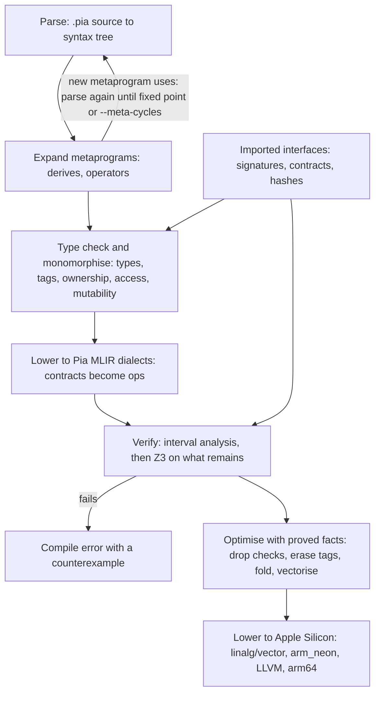

# Pia language design

Status: accepted baseline, 2026-11-20. Each decision here is recorded with its reasoning in [`docs/adr/`](adr/README.md). When an ADR and this document disagree, the ADR wins, and this document should be fixed.

## Purpose and principles

Pia is a formally verified language with an OCaml-like surface and Lisp-style metaprogramming. At compile time a solver (Z3) and cheaper formal methods (interval analysis, set reasoning) prove that each module is internally consistent and keeps the contracts it advertises.

The first milestone is a toy compiler written in C++ on MLIR. It proves and compiles simple SIMD data-processing pipelines for Apple Silicon. The flagship demo is stream delineation (see [Stress test](#stress-test-stream-delineation)).

Principles:

- **Proved, not checked.** Every bounds check, overflow rule and contract is a proof obligation at compile time. A runtime check survives only where the source asks for one. The strongest guarantee is always the default.
- **One binding form.** `let` binds every value, including functions and types.
- **Explicit effects at the boundary.** Ownership, access and mutability are written on parameters, so a module's interface says everything the prover needs.
- **Metaprogramming is part of the core.** Derived code (serialisation, equality, operators) is generated before verification and proved like hand-written code.
- **Fold everything foldable.** Facts the prover establishes feed constant folding and vectorisation.
- **Modules are the unit of proof, build and link.** Imports name the interfaces they need, so modules build and verify in parallel.

## Bindings and functions

`let` is the only binding keyword. A function is a value whose type is an arrow, so naming a function and naming a number look the same.

```ocaml
let width : u32 = 1024
let square = let (x : i32) => x * x
let square (x : i32) : i32 = x * x        (* sugar for the line above *)
let compose f g = let (x) => f (g x)      (* functions take and return functions *)

let rec sum (xs : [i32]) (i : usize) : i64 =   (* recursion needs rec *)
  if i = len xs then 0 else widen xs.[i] + sum xs (i + 1)

let total =
  let a = 3 in
  let b = a * 2 in
  a + b                                    (* local scope with let ... in *)
```

A nameless `let` is a function literal: `let (x) => x * x` is a function object, so there is no `fun` or `lambda` keyword. Function literals are curried, so applying one to fewer arguments returns a function. Several parameters are written `let (a) (b) => a + b`, and each may carry types and modifiers like a named function's parameters.

- Bindings are immutable. Mutation happens only through a `mutable` parameter or a `mutable` local.
- `let rec` marks recursion, which the prover must see to demand a termination measure (`decreases`).
- Closures capture by borrow unless the capture is written `move`, so the ownership checker sees every capture.
- Top-level `let` in a module is private unless the module's interface exports it.

## Type system

Every expression has a static type, and there are no implicit conversions. Dynamic typing exists only as `dyn`, a tagged value whose tag is a closed sum the prover can enumerate.

```ocaml
let shape = type                     (* types are values, so let binds them too *)
  | Circle of f32
  | Rect of { w : f32; h : f32 }

let v : dyn = dyn 42u8              (* tag = u8, payload = 42 *)

let describe (v : dyn) : str =
  match v with
  | (x : u8)  -> "byte"
  | (x : f32) -> "float"
  | _         -> "other"           (* the prover checks this is exhaustive over the tags in scope *)
```

Types are compile-time values of type `type`, bound with `let` like anything else. There is no `type` declaration keyword: `type` is only the constructor expression on the right-hand side. A function from types to types is an ordinary function evaluated at compile time: `let pair = let (a : type) (b : type) => type { fst : a; snd : b }`.

- A `dyn` is a pair of tag and payload in the proof model. Each tag maps to a Z3 datatype constructor, so a match over `dyn` is a case split the solver can check for exhaustiveness and reachability.
- The set of tags a `dyn` may hold is part of its type when known (`dyn[u8 | f32]`), which narrows the case split.
- Lowering erases a tag when the prover shows only one tag reaches that point, and erases the whole `dyn` when every use is resolved. The proof keeps the tags. The machine code does not.
- Generics are monomorphised before verification, so every proof is about concrete types.

## Primitive types and overflow

Integers are bounded and every arithmetic op has a declared overflow behaviour. The default is `@overflow(proof)`: the compiler must prove the result fits, or compilation fails.

| Type | Meaning |
| --- | --- |
| `u8` `u16` `u32` `u64` `i8` ... `i64` | machine integers, modelled as Z3 bit-vectors |
| `usize` | index type, bounded by the array it indexes |
| `f16` `f32` `f64` | IEEE floats, modelled with Z3's floating-point theory |
| `bool` | true or false |
| `int{lo..hi}` | range type: an integer with static bounds, stored in the smallest fitting width |

| Attribute | On overflow | Proof obligation |
| --- | --- | --- |
| `@overflow(proof)` (default) | cannot happen | result stays in range |
| `@overflow(wrap)` | modular wrap | none |
| `@overflow(saturate)` | clamp to min or max | none, maps to NEON saturating ops |
| `@overflow(trap)` | runtime trap | none, but the trap is visible in the contract |

```ocaml
let add_px (a : u8) (b : u8) : u8 @overflow(saturate) = a + b   (* lowers to uqadd *)
let idx (i : int{0..255}) : u8 = lut.[i]                      (* no bounds check: range proves it *)
let bad (a : u8) (b : u8) : u8 = a + b                         (* rejected: counterexample a=200, b=100 *)
```

The attribute can sit on a type (`u8 @overflow(wrap)`), a function, or a single expression (`@wrap (a + b)`). Floats get the same idea for NaN and infinity: `@finite` asks the prover to show no NaN or infinity is produced.

## Function parameters

Each parameter carries up to three modifiers, one per axis, and omitted ones take the default. The default is `borrowed in fixed`, a read-only borrow, so the common case needs no annotation.

| Axis | Options | Default | What the prover gets |
| --- | --- | --- | --- |
| Ownership | `borrowed`, `moved` | `borrowed` | a moved value is dead in the caller after the call, so no aliasing to track |
| Access | `in`, `out`, `inout` | `in` | `out` must be fully written before return, `in` is never written |
| Modifiability | `fixed`, `mutable` | `fixed` | a `fixed` value's model is one constant for the whole call |

```ocaml
let scale
    (src : borrowed in [f32; n])
    (dst : borrowed out mutable [f32; n])
    (k   : f32)
  : unit
  requires n mod 4 = 0
  ensures forall i in 0..n. dst.[i] = src.[i] * k
= for i in 0..n do dst.[i] <- src.[i] * k done

let consume (buf : moved inout mutable [u8]) : [u8] = ...   (* takes ownership, may change and return it *)
```

Combination rules (proposed, not yet confirmed):

- `out` and `inout` imply `mutable`, so writing `out fixed` is an error.
- Two `mutable` borrows may not alias. The checker proves disjointness of array slices, which lets `dst` and `src` be parts of one buffer.
- `moved in fixed` is allowed and means the callee owns a read-only value it may free or store.

## Structs, arrays and vectors

Structs and arrays are values: they can be bound, passed, returned and compared like integers. Array length is part of the type when known, which is what lets the prover discharge bounds checks.

```ocaml
let pixel = type { r : u8; g : u8; b : u8; a : u8 }

let black : pixel = { r = 0; g = 0; b = 0; a = 255 }
let dim = { black with a = 128 }           (* functional update *)

let lut   : [u8; 256]  = ...                (* fixed length, known at compile time *)
let frame : [pixel; n] = ...                (* length is a type-level variable n *)
let row   : [pixel]    = frame.[0 .. w]     (* slice: length carried as a value the prover tracks *)

let v : vec<u8, 16> = splat 0u8             (* SIMD vector, maps to a 128-bit NEON register *)
```

- `[T; n]` is a fixed array, `[T]` a slice with a proved length, and `vec<T, k>` a SIMD vector with `k * sizeof T` equal to 64 or 128 bits.
- Indexing `a.[i]` creates the obligation `0 <= i < len a`. A failed proof is a compile error with a counterexample.
- Layout attributes (`@packed`, `@align(16)`, `@soa`) control memory layout. `@soa` stores `[pixel; n]` as four `[u8; n]` arrays, which is often what SIMD wants.
- Equality, ordering and serialisation of structs are not built in. They are derived by metaprograms.

### Generic types and concepts

Because types are values, a generic type is a compile-time function that returns a type, and users define their own with the same `let`. Constraints on type parameters are concepts. A concept is a metaprogram that inspects a type and either accepts it or returns a diagnostic.

```ocaml
(* a concept: a compile-time predicate over types, written as a metaprogram *)
let meta Numeric (t : type) : concept =
  has_fn t `( add  : $t -> $t -> $t ) &&
  has_fn t `( mul  : $t -> $t -> $t ) &&
  has_val t `( zero : $t )

let meta Eq (t : type) : concept =
  has_fn t `( eq : $t -> $t -> bool )
  && law `( forall (a : $t). eq a a )                (* a law: proved by Z3 for each instance *)

(* user-defined generic types *)
let pair = let (a : type) (b : type) => type { fst : a; snd : b }
let matrix = let (t : type where Numeric t) (rows : usize) (cols : usize) => type [t; rows * cols]

(* a generic function, checked against the concept once, then monomorphised *)
let sum (t : type where Numeric t) (xs : borrowed in [t]) : t = fold add zero xs

let p : pair u8 f32 = { fst = 1; snd = 2.0 }
let s = sum [1; 2; 3]                                (* t deduced as i32 from the call site *)
let w = sum<i64> [1; 2; 3]                           (* explicit: forces the i64 instance *)
```

- **Definition check.** A generic body may use only what its concepts promise. `sum` can call `add` and `zero` but not `<`, so a body error is reported at the definition, not at a later instantiation.
- **Use check.** At each instantiation the concept metaprogram runs on the concrete type. A failure reports the concept's own message, such as "f16 lacks zero".
- **Laws.** A concept can state laws, such as reflexive equality or associative addition. Every instance must prove them, with no `@assume` escape. The optimiser may then rely on them, for example to reassociate a reduction for SIMD.
- **Adapters.** A type that does not meet a concept gets an adapter: a value that supplies the functions the concept checks for, with its laws proved like any other instance. An adapter can be written in any module, not only the one that defines the concept or the type.
- **Derives fit in.** `@derive(eq)` generates the functions that the `Eq` concept checks for, so derived types satisfy concepts with no extra code.
- **Deduction.** Type arguments are deduced from the call site by default. Explicit arguments with angle brackets (`sum<i64> xs`) force a particular instance or resolve an overload.
- `vec<T, k>` is an ordinary generic from the prelude, `let vec = let (t : type where Lane t) (k : usize where k * size_of t in {64; 128}) => type ...`, and the angle brackets are sugar for applying it.

```ocaml
(* f32's built-in = fails Eq's law: NaN = NaN is false. An adapter fixes that. *)
let eq_f32 : adapter Eq f32 = { eq = let (a) (b) => bits a = bits b }   (* bitwise, so eq a a holds *)

let unique = dedup<f32, eq_f32> samples      (* the adapter is named where it is used *)
```

## Contracts

A contract is any claim the prover must establish, and Pia has four forms. All four lower to the same thing: ops in Pia's contract dialect that become solver assertions.

| Form | Where | Example |
| --- | --- | --- |
| Refinement type | any type | `let byte_idx = int{0..255}`, `{ x : f32 \| x >= 0.0 }` |
| Pre and postcondition | function | `requires n > 0`, `ensures result <= max xs` |
| Invariant | loop, struct, module | `invariant acc <= i * 255` |
| State property | module | an exported `state` symbol, changed only as exported pre/postconditions allow |

```ocaml
let range = type { lo : i32; hi : i32 } where lo <= hi      (* struct invariant *)

let clamp (r : range) (x : i32) : { y : i32 | r.lo <= y && y <= r.hi } =
  if x < r.lo then r.lo else if x > r.hi then r.hi else x

interface Stream = sig
  let status = type | Closed | Open | Drained
  let state : status                      (* exported state is just another symbol *)
  let open_ : unit -> unit
    requires state = Closed   ensures state = Open
  let pull  : unit -> [u8]
    requires state = Open     ensures state = Open || state = Drained
  let close : unit -> unit
    requires state <> Closed  ensures state = Closed
end
```

- Module state needs no special syntax. An interface is a set of exported symbols, each with its type and its pre- and postconditions, and exported state is one more symbol. An importer proves each call against those contracts, so calling `pull` on a closed stream fails to verify. The exporting module proves its bodies keep every postcondition.
- Interval analysis runs first and discharges most bounds and overflow obligations cheaply. Only what remains goes to Z3.
- An unproved obligation is an error by default. `@assume` accepts it with a visible note in the interface (never for concept laws), and `@check` turns it into a runtime check.

## Metaprogramming and operators

A metaprogram is an ordinary Pia function that runs at compile time and takes and returns syntax. Code is data in the Lisp sense: `` `( ... ) `` quotes a piece of code as a syntax value, and `$x` splices a value back in. Everything a metaprogram generates is type checked and verified like hand-written code.

```ocaml
(* a derive: generate structural equality for any struct *)
let meta derive_eq (t : type_decl) : item =
  let cmps = map (let (f) => `( a.$f = b.$f )) (fields t) in
  `( let eq (a : $t) (b : $t) : bool = $(fold_and cmps) )

let pixel = type { r : u8; g : u8; b : u8; a : u8 } @derive(eq, serialise, deserialise)
```

Operators exist only through metaprograms. The core language has named functions (`add`, `mul_sat`), and an `operator` declaration maps a symbol, a precedence and the operand types to an expansion:

```ocaml
let meta operator ( + ) : prec 6 left = let (a) (b) => `( add $a $b )
let meta operator ( +| ) : prec 6 left = let (a) (b) => `( add_sat $a $b )   (* saturating add *)
let meta operator ( + ) for vec<T, k> = let (a) (b) => `( vec_add $a $b )
```

Design decisions:

- **Stages.** Expansion runs to a fixed point. Code a metaprogram generates is parsed again, and any new metaprogram uses in it (a derive that emits a derive, an operator that expands to another operator) run in turn. Metaprograms see types only once they are fully resolved. A type may itself be generated by another metaprogram in a later pass, so a metaprogram that asks for an unresolved type is deferred to the next pass. The loop stops when a pass generates nothing new and nothing is waiting. A metaprogram still waiting at that point is an error that names the type it needed. This cost is deliberate: every generated item comes out of the loop as ordinary code that is then proved. Hygiene is on by default, and `$!name` breaks it on purpose.
- **Termination.** A compiler flag such as `--meta-cycles=N` caps the number of expansion passes. Hitting the cap is a compile error that names the metaprograms still producing code. A fuel limit inside a single metaprogram is still useful, and proving termination of macros is a later option.
- **Serialisation targets.** The first derives are `eq`, `ord`, `hash`, `serialise` and `deserialise`. A `deserialise` derive also emits the refinement checks, so a parsed value is proved to meet its type's invariants.
- **Prelude.** `+ - * / < = ...` are defined by operator metaprograms in a prelude module that every module imports by default.

## Modules, interfaces and imports

A module is the unit of proof, build and link. It exports named interfaces, and an importer must name each interface it uses, so a module depends on interface files only, never on another module's body.

```ocaml
(* pixels.pia *)
interface PixelOps = sig
  let pixel : type
  let blend : (a : pixel) -> (b : pixel) -> (t : int{0..255}) -> pixel
    ensures result.a = max a.a b.a
end

interface PixelCodec = sig
  let encode : borrowed in [pixel] -> [u8]
  let decode : borrowed in [u8] -> [pixel] | Error
end

module Pixels : PixelOps, PixelCodec = struct ... end

(* filter.pia *)
import Pixels.PixelOps                (* only PixelOps is visible, so filter.pia never rebuilds when PixelCodec changes *)
```

- An interface is a set of exported symbols, each with its type, interface and pre- and postconditions. Each interface compiles on its own to a small artifact. Every module that imports it can then type check, verify and compile at once, in parallel.
- Verification is assume-guarantee. A module proves its body meets its exported contracts while assuming the contracts of the interfaces it imports. No proof ever looks inside another module.
- Each compiled module carries a proof certificate that records a hash of every interface it was proved against. The linker refuses to link when a hash does not match, so a stale proof cannot reach the binary. Shared libraries publish their interfaces and certificates in the binary, and dyld and the Pia runtime refuse a library that does not provide the hashes a program was proved against ([abi.md](abi.md), [ADR 0024](adr/0024-published-proof-certificates.md)).
- An interface may export a fixed value as a symbol. Importers see its name, type and refinement, and prove against those, so they still build in parallel. The value itself is resolved later, when cross-module constant folding runs. Changing an exported value invalidates the certificates that depend on it and forces dependents to recompile. Inlining works the same way through `let inline` and `const` symbols.

## Compilation pipeline

Verification sits in the middle of the pipeline: after metaprograms expand, so generated code is proved, and before optimisation, so proved facts drive folding and vectorisation.



Imported interfaces feed type checking and verification as assumptions, which is why modules can build in parallel. An unproved obligation stops the build with a counterexample mapped back to the source line. The optimiser auto-vectorises every loop it can prove safe, using proved trip counts, alignment and non-aliasing. `vec<T, k>` is there when the author wants to fix the vector shape.

## Example pipelines

These become the first test suite.

- Saturating add of two `u8` images
- Dot product of two `f32` arrays
- Clamp and scale an `f32` buffer into `u8`
- One serialise and deserialise round trip, to exercise derives
- Tiled matrix multiply generated by a metaprogram from tile sizes

### Tiled matrix multiply as a metaprogram

Tile sizes are compile-time arguments to a metaprogram, so each instance is a separate, fully unrolled function with its own proof. The spec is the naive triple loop, and the generated body must be proved equal to it.

```ocaml
let meta tiled_matmul
    (name : ident) (t : type where Numeric t)
    (tm : usize) (tn : usize) (tk : usize)        (* register tile and k block *)
    (lanes : usize where lanes * size_of t = 16)  (* one 128-bit NEON register *)
  : item =
  let cols = tn / lanes in                         (* vectors per tile row *)
  `( let $name (m : usize) (n : usize) (k : usize)
         (a : borrowed in [$t; m * k])
         (b : borrowed in [$t; k * n])
         (c : borrowed out mutable [$t; m * n])
       : unit
       requires m mod $tm = 0 && n mod $tn = 0 && k mod $tk = 0
       ensures forall (i in 0..m) (j in 0..n).
         c.[i * n + j] = sum (0..k) (let (p) => a.[i * k + p] * b.[p * n + j])
     =
       for i0 in 0..m step $tm do
       for j0 in 0..n step $tn do
         let acc : mutable [vec<$t, $lanes>; $tm * $cols] = splat zero in
         for p0 in 0..k step $tk do
           $(unroll tk (let (pp) =>
             unroll tm (let (ii) =>
               `( let av = splat a.[(i0 + $ii) * k + p0 + $pp] in
                  $(unroll cols (let (jj) =>
                    `( let bv = load b ((p0 + $pp) * n + j0 + $jj * $lanes) in
                       acc.[$ii * $cols + $jj] <- fma acc.[$ii * $cols + $jj] av bv ))) ))))
         done;
         $(unroll tm (let (ii) => unroll cols (let (jj) =>
           `( store c ((i0 + $ii) * n + j0 + $jj * $lanes) acc.[$ii * $cols + $jj] ))))
       done done )

(* one instance for Apple Silicon: 4 x 16 f32 register tile, k blocked by 64 *)
tiled_matmul `sgemm_4x16 f32 4 16 64 4
```

- **Metaprogram helpers.** `unroll n f` is itself a metaprogram that splices `f 0` to `f (n - 1)`. Its output contains further quotes, so expansion takes several passes to reach its fixed point.
- **Constraints on meta arguments.** `lanes * size_of t = 16` is checked when the metaprogram is called, so a tile that does not fit a NEON register fails before any code is generated.
- **Bounds proofs from preconditions.** Every `load`, `store` and index is in range because of the `requires` clause and the loop steps. Interval analysis should discharge these without Z3.
- **Proving the tiled body against the spec.** This holds exactly for integer `t` (with overflow proved). For `f32`, tiling reassociates the sum, so one of the approaches below is needed.

### Floating-point reassociation: three approaches

The default is strict IEEE semantics, so the tiled `f32` matmul fails to verify until the author picks one of these. All three are part of Pia, and each trades a different guarantee.

**1. Per-function attribute.** The author licenses reassociation and fused multiply-add for one function. The prover checks `ensures` over real numbers, ignoring rounding, and codegen may reorder and fuse.

```ocaml
let sgemm (...) : unit @fp(reassoc, contract)
  ensures ... (* proved over reals *)
= ...
```

**2. A type with a concept adapter.** A wrapper type carries the licence, so it travels with the data instead of the function. Its `Numeric` adapter models addition as real addition in the proof, which lets the associativity law prove. Codegen still emits hardware floats.

```ocaml
let fast = let (t : type where Float t) => type t @fp(reassoc)
let numeric_fast_f32 : adapter Numeric (fast f32) = { add = fadd_reassoc; mul = fmul; zero = 0.0 }

tiled_matmul `sgemm_4x16 (fast f32) 4 16 64 4
```

**3. A tolerance in the contract.** Semantics stay strict IEEE, and `ensures` states an error bound instead of equality. This is the strongest guarantee and the hardest to prove. Bit-precise Z3 floats will not scale here, so it needs a rounding-error analysis pass in the style of interval analysis.

```ocaml
ensures forall (i in 0..m) (j in 0..n).
  abs (c.[i * n + j] - spec i j) <= k * eps f32 * sum (0..k) (let (p) => abs a.[i * k + p] * abs b.[p * n + j])
```

| Approach | Licence lives on | What is proved | Proof cost |
| --- | --- | --- | --- |
| `@fp(reassoc)` | one function | result over reals | low |
| `fast f32` adapter | the type and its data | result over reals, law per instance | low |
| Tolerance | the contract | IEEE result within a stated bound | high |

## Stress test: stream delineation

Stream delineation is the end-to-end program that exercises everything at once: image I/O, SIMD stencils, a graph algorithm, a conservation law and distributed execution. Input is a PNG or GIF heightmap. Output is a PNG or GIF with streams drawn and coloured by sediment load.

1. **Decode** the heightmap with `Image.Png` or `Image.Gif`. Decoding is a derived `deserialise`, so a decoded `[u16; w * h]` is proved to have the declared size and range.
2. **Fill depressions** (priority-flood) so every cell can drain. Proved invariant: after filling, every non-outlet cell has a neighbour that is lower, or equal and closer to an outlet.
3. **Flow direction** (D8): each cell points to its steepest downhill neighbour. This is a 3 x 3 stencil and auto-vectorises. The invariant from step 2 proves the direction graph has no cycles.
4. **Flow accumulation**: each cell's upstream area, computed in topological order over that acyclic graph. Proved: every cell is visited exactly once.
5. **Sediment transport**: erosion from slope and accumulated flow, deposition where the slope flattens, iterated over time steps. Proved conservation law: total sediment eroded equals total deposited plus total leaving through outlets, within the chosen float tolerance.
6. **Render**: cells above a flow threshold become streams, coloured by sediment load through a colour map, then `Image.Png.encode` or `Image.Gif.encode`.

### Concurrency by default

The runtime is concurrent by default, with MPI-like collectives as library metaprograms. The grid is split into tiles, each tile is `moved` to a worker, and neighbouring tiles exchange halo rows between steps.

```ocaml
import Pia.Par.Collectives          (* scatter, gather, halo_exchange, all_reduce *)
import Image.Png.Codec

let sediment_step (grid : borrowed in mutable tiled<cell, 256, 256, halo = 1>) : unit
  ensures total_mass grid = old (total_mass grid) - outflow grid
=
  halo_exchange grid;                               (* neighbours' edge rows, before any stencil read *)
  spread tile in grid @place(auto) do                (* the compiler picks CPU cores or GPU per tile *)
    erode_and_deposit tile
  done;
  let lost = all_reduce add (map outflow_of grid) in  (* collective: every worker joins *)
  record_outflow grid lost
```

What the prover must establish for this to count as correct by construction:

- **No data races.** Each tile is owned by exactly one worker (`moved`), and halo rows are read-only `borrowed` copies.
- **Stencils stay in bounds.** A 3 x 3 read touches at most 1 cell outside its tile, which is exactly what `halo = 1` provides.
- **Collectives match.** Every worker reaches every `all_reduce` and `halo_exchange` in the same order, so no worker waits forever. A protocol metaprogram checks at compile time that every worker issues the same sequence of collectives. A model checker pass then explores the interleavings that the protocol check cannot settle on its own.
- **Placement does not change results.** Moving a tile from CPU to GPU must not change the proved result, which ties back to the float rules.

Concurrency features are built in the order this demo needs them: collectives and `spread` loops first, then a task graph for flow accumulation (tiles wait on their upstream neighbours), then futures.

Placement has three forms. `@place(auto)` lets the compiler's cost model choose. `@place(gpu)` or `@place(cpu)` fixes the device. `@place(auto, prefer = gpu)` keeps the cost model but overrides its choice. CPU cores and the GPU (through Metal) are reachable from MLIR. The Neural Engine is only reachable through Core ML, so it fits fixed operations such as convolutions, and is a later, optional target.

## Implementation

- Compiler in C++ on MLIR, with Z3 as the solver. See [ADR 0011](adr/0011-mlir-and-z3-implementation.md).
- Build with Bazel (bzlmod), depending on LLVM/MLIR and Z3 as Bazel modules rather than vendored checkouts. See [ADR 0017](adr/0017-bazel-build.md).
