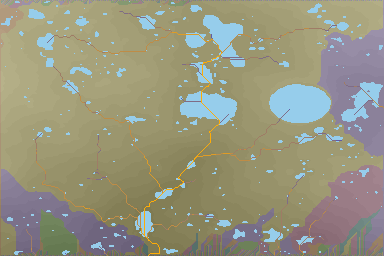

# Demo: sediment transport

The second half of the [stream delineation demo](streams.pia.md) moves
sediment over the landscape the first half delineated ([ADR
0055](adr/0055-sediment-transport-in-fixed-point.md)). Sediment is counted
in whole units of mass, a `u32` per cell, in three buffers: `bed`, the
erodible sediment resting in each cell; `load`, what the water leaving a
cell carries; and `inflow`, what drains into it. One more number, `gone`,
counts what has left the map through outlets.

Each cell's water has a **capacity**, how much it can carry. Where it
carries less, it erodes the bed, at most the whole bed; where it carries
more, it deposits the excess. A step visits the cells from highest to
lowest, so every cell is visited after the cells that drain into it, and
each cell's load moves on to the cell below, or off the map.

The theorem is that the total never changes:

```text
sum bed + sum load + sum inflow + gone = old (the same)
```

exactly, in whole units, with no tolerance. It is the postcondition of
every function below, from a single write to `n` time steps over the whole
map, and it bounds every cell, so nothing overflows.

Here is the result: three "years" of rain over the demo's 384×256 test
terrain. Each year has uniform rain, then a storm band moving down the map,
then a wet season and a dry one, and each frame is one epoch of 4 steps
(section 6). Streams are coloured blue to orange by the sediment they carry,
lakes are pale blue, and every other cell takes its watershed's tint, shaded
by height. Before each epoch, the ground is the rock plus the deposited
sediment, and the flow is recomputed over it. The whole animation conserves
mass exactly: 7,276,468 units stay on the map and 2,553,932 leave through
outlets, the 9,830,400 it started with.



The proved GIF encoder ([ADR 0054](adr/0054-proved-gif-and-inflate-codecs.md))
writes the animation. To make it yourself, run `bazel run //examples/streams`
with no arguments, which writes `streams-output-evolution.gif`.

This page is the program, a literate Pia file like
[`streams.pia.md`](streams.pia.md) and its own module, so the two prove in
parallel. The C program in `examples/streams` calls `sediment` with the
filled heights, the flow directions and the accumulation from the first
half, and draws the result with `render_load` from that page.

```pia
module Sediment : Transport

interface Transport @abi(c) = sig
  let sediment : (fill : [u16]) -> (down : [usize]) -> (acc : [u32])
      -> (n : u32) -> (bed : inout mutable [u32])
      -> (load : out mutable [u32]) -> (inflow : out mutable [u32])
      -> (flux : out mutable [u32]) -> (order : out mutable [usize])
      -> (pos : out mutable [usize]) -> (cnt : out mutable [u32])
      -> (first : out mutable [usize]) -> (next : out mutable [usize])
      -> (last : out mutable [usize]) -> (owner : out mutable [u16]) -> u64
    requires len down = len fill && len acc = len fill
    requires len bed = len fill && len load = len fill && len inflow = len fill
    requires len flux = len fill && len order = len fill && len pos = len fill
    requires len owner = len fill && len fill < max u32
    requires len cnt = max u16 + 1 && len first = max u16 + 1 && len next = max u16 + 1 && len last = max u16 + 1
    requires forall (k in 0..len down).
               down.[k] = k || (down.[k] < len fill && fill.[down.[k]] < fill.[k])
  let surface : (rock : [u16]) -> (bed : [u32]) -> (height : out mutable [u16])
      -> unit
    requires len bed = len rock && len height = len rock
  let rain_uniform : (r : u8) -> (rain : out mutable [u32]) -> unit
    requires len rain <= 16'777'215
  let rain_band : (w : usize) -> (lo : usize) -> (hi : usize) -> (inside : u8)
      -> (outside : u8) -> (rain : out mutable [u32]) -> unit
    requires w > 0 && len rain <= 16'777'215
  let rain_season : (wet : bool) -> (r : u8) -> (rain : out mutable [u32]) -> unit
    requires len rain <= 16'777'215
  let drainage : (fill : [u16]) -> (down : [usize]) -> (acc : out mutable [u32])
      -> (basin : out mutable [usize]) -> (rain : out mutable [u32])
      -> (pend : out mutable [u32]) -> (order : out mutable [usize])
      -> (pos : out mutable [usize]) -> (cnt : out mutable [u32])
      -> (first : out mutable [usize]) -> (next : out mutable [usize])
      -> (last : out mutable [usize]) -> (owner : out mutable [u16]) -> unit
    requires len down = len fill && len acc = len fill && len basin = len fill
    requires len rain = len fill && len pend = len fill
    requires len order = len fill && len pos = len fill && len owner = len fill
    requires len fill < max u32
    requires len cnt = max u16 + 1 && len first = max u16 + 1 && len next = max u16 + 1 && len last = max u16 + 1
    requires forall (j in 0..len down).
               down.[j] = j || (down.[j] < len fill && fill.[down.[j]] < fill.[j])
  let evolve : (fill : [u16]) -> (down : [usize]) -> (rain : [u32]) -> (k : u32)
      -> (bed : inout mutable [u32]) -> (load : inout mutable [u32])
      -> (inflow : inout mutable [u32]) -> (flux : out mutable [u32])
      -> (flow : out mutable [u32]) -> (pend : out mutable [u32])
      -> (order : out mutable [usize]) -> (pos : out mutable [usize])
      -> (cnt : out mutable [u32]) -> (first : out mutable [usize])
      -> (next : out mutable [usize]) -> (last : out mutable [usize])
      -> (owner : out mutable [u16]) -> u64
    requires len down = len fill && len rain = len fill
    requires len bed = len fill && len load = len fill && len inflow = len fill
    requires len flux = len fill && len flow = len fill && len pend = len fill
    requires len order = len fill && len pos = len fill && len owner = len fill
    requires len fill < max u32
    requires len cnt = max u16 + 1 && len first = max u16 + 1 && len next = max u16 + 1 && len last = max u16 + 1
    requires forall (j in 0..len down).
               down.[j] = j || (down.[j] < len fill && fill.[down.[j]] < fill.[j])
end
```

## 1. The sum and the point update

```pia
let spec elt (xs : [u32]) (i : usize) : u32
  requires i < len xs
= xs.[i]
```

`sum xs n` is the sum of `xs.[0 .. n]`, a `u64`. An element is read through
`elt`, whose `u32` result type tells the solver the element's range each
time `sum` unfolds. The bound in the `ensures` keeps the `u64` from
overflowing; it is the one product in this stage, and it widens the
encoding only for the functions that use `sum` (docs/verifier.md,
"Encoding").

```pia
let spec sum (xs : [u32]) (n : usize) : u64
  requires n <= len xs && n <= max u32 + 1
  ensures result <= (max u32 + 1) * n
  decreases n
= if n = 0 then 0 else sum xs (n - 1) + elt xs (n - 1)
```

The lemmas about `sum` are proved by induction. Each inductive step goes
through one of three small lemmas with no quantifier in sight: with a
`forall` among the facts, the solver does not find the one-step unfolding
by itself.

```pia
let lemma step (xs : [u32]) (ys : [u32]) (n : usize) : unit
  requires 0 < n && n <= len xs && n <= len ys && n <= max u32 + 1
  requires sum ys (n - 1) = sum xs (n - 1) && ys.[n - 1] = xs.[n - 1]
  ensures sum ys n = sum xs n
= ()
```

```pia
let lemma step_after (xs : [u32]) (ys : [u32]) (i : usize) (n : usize) : unit
  requires i < n - 1 && n <= len xs && n <= len ys && n <= max u32 + 1
  requires sum ys (n - 1) + xs.[i] = sum xs (n - 1) + ys.[i] && ys.[n - 1] = xs.[n - 1]
  ensures sum ys n + xs.[i] = sum xs n + ys.[i]
= ()
```

```pia
let lemma step_at (xs : [u32]) (ys : [u32]) (i : usize) : unit
  requires i < len xs && i < len ys && i < max u32 + 1
  requires sum ys i = sum xs i
  ensures sum ys (i + 1) + xs.[i] = sum xs (i + 1) + ys.[i]
= ()
```

If `ys` is `xs` except at `i`, the prefixes before `i` have the same sum.

```pia
let lemma frame (xs : [u32]) (ys : [u32]) (i : usize) (n : usize) : unit
  requires len xs = len ys && n <= i && i < len xs && len xs <= max u32 + 1
  requires forall (k in 0 .. len xs). k <> i ==> ys.[k] = xs.[k]
  ensures sum ys n = sum xs n
  decreases n
= if n > 0 then (frame xs ys i (n - 1); assert ys.[n - 1] = xs.[n - 1]; step xs ys n)
```

The **point update**: writing `ys.[i]` in place of `xs.[i]` changes the sum
of every prefix that holds `i` by `ys.[i] - xs.[i]`. Every move of sediment
is a pair of such writes.

```pia
let lemma update (xs : [u32]) (ys : [u32]) (i : usize) (n : usize) : unit
  requires len xs = len ys && i < n && n <= len xs && len xs <= max u32 + 1
  requires forall (k in 0 .. len xs). k <> i ==> ys.[k] = xs.[k]
  ensures sum ys n + xs.[i] = sum xs n + ys.[i]
  decreases n
= if n > i + 1 then (update xs ys i (n - 1); assert ys.[n - 1] = xs.[n - 1]; step_after xs ys i n)
  else (frame xs ys i i; step_at xs ys i; assert n = i + 1)
```

```pia
let lemma at_le (xs : [u32]) (i : usize) : unit
  requires i < len xs && i < max u32 + 1
  ensures xs.[i] <= sum xs (i + 1)
= ()
```

A longer prefix has a larger sum.

```pia
let lemma mono (xs : [u32]) (m : usize) (n : usize) : unit
  requires m <= n && n <= len xs && n <= max u32 + 1
  ensures sum xs m <= sum xs n
  decreases n
= if n > m then mono xs m (n - 1)
```

Each element is at most the sum, so a bound on the total bounds every cell.
This is what proves that no cell overflows when mass arrives.

```pia
let lemma elt_le (xs : [u32]) (i : usize) (n : usize) : unit
  requires i < n && n <= len xs && n <= max u32 + 1
  ensures xs.[i] <= sum xs n
= at_le xs i; mono xs (i + 1) n
```

An all-zero prefix sums to zero.

```pia
let lemma zero (xs : [u32]) (n : usize) : unit
  requires n <= len xs && n <= max u32 + 1
  requires forall (k in 0 .. n). xs.[k] = 0
  ensures sum xs n = 0
  decreases n
= if n > 0 then (zero xs (n - 1); assert xs.[n - 1] = 0)
```

`set` is a write whose contract is the point update for the whole buffer.
The element is loaded before it is overwritten: the load is what tells the
solver that `old (xs.[i])` is a `u32`.

```pia
let set (xs : borrowed inout mutable [u32]) (i : usize) (v : u32) : unit
  requires i < len xs && len xs <= max u32 + 1
  ensures xs.[i] = v
  ensures forall (k in 0 .. len xs). k <> i ==> xs.[k] = old (xs.[k])
  ensures sum xs (len xs) + old (xs.[i]) = sum (old xs) (len xs) + v
= let w = xs.[i] in
  xs.[i] <- v;
  update (old xs) xs i (len xs);
  assert w = old (xs.[i])
```

```pia
let cell = type { bed : u32; load : u32 }
```

The water erodes when it carries less than its capacity, at most the whole
bed, and deposits the excess otherwise. Mass moves between bed and load and
none is created.

```pia
let erode_or_deposit (inflow : u32) (capacity : u32) (bed : u32) : cell
  requires bed + inflow <= max u32
  ensures result.bed + result.load = bed + inflow
  ensures inflow < capacity ==> result.bed <= bed && inflow <= result.load && result.load <= capacity
  ensures capacity <= inflow ==> bed <= result.bed && result.load = capacity
= if inflow < capacity then
    (let room = capacity - inflow in
     let e = if room < bed then room else bed in
     { bed = bed - e; load = inflow + e })
  else { bed = bed + (inflow - capacity); load = capacity }
```

`push` moves the load of cell `a` into the inflow of cell `b`, downhill.

```pia
let push (load : borrowed inout mutable [u32]) (inflow : borrowed inout mutable [u32]) (a : usize) (b : usize) : unit
  requires a < len load && b < len inflow && len load <= max u32 + 1 && len inflow <= max u32 + 1
  requires sum load (len load) + sum inflow (len inflow) <= max u32
  ensures load.[a] = 0
  ensures forall (k in 0 .. len load). k <> a ==> load.[k] = old (load.[k])
  ensures sum load (len load) + sum inflow (len inflow) = sum (old load) (len load) + sum (old inflow) (len inflow)
= let m = load.[a] in
  let w = inflow.[b] in
  elt_le load a (len load);
  elt_le inflow b (len inflow);
  set load a 0;
  set inflow b (w + m)
```

`drain`: the load of an outlet leaves the map.

```pia
let drain (load : borrowed inout mutable [u32]) (a : usize) (gone : u64) : u64
  requires a < len load && len load <= max u32 + 1
  requires sum load (len load) + gone <= max u32
  ensures load.[a] = 0
  ensures forall (k in 0 .. len load). k <> a ==> load.[k] = old (load.[k])
  ensures sum load (len load) + result = sum (old load) (len load) + gone
= let m = load.[a] in
  elt_le load a (len load);
  set load a 0;
  gone + m
```

The arithmetic that adds `erode_cell`'s three writes up. On its own it is a
small goal; inline, the solver times out on it among the sums.

```pia
let lemma balance (a : u64) (b : u64) (c : u64) (a0 : u64) (b0 : u64) (c0 : u64) (d : u32) (i : u32) (rb : u32) (rl : u32) : unit
  requires a + d = a0 + rb && b = b0 + rl && c + i = c0 && rb + rl = d + i
  ensures a + b + c = a0 + b0 + c0
= ()
```

## 2. One cell

`erode_cell`: a cell takes its inflow and erodes or deposits. Its bed and
load are rewritten and its inflow is spent.

```pia
let erode_cell (bed : borrowed inout mutable [u32]) (load : borrowed inout mutable [u32]) (inflow : borrowed inout mutable [u32]) (c : usize) (capacity : u32) : unit
  requires c < len bed && c < len load && c < len inflow
  requires len bed <= max u32 + 1 && len load <= max u32 + 1 && len inflow <= max u32 + 1
  requires sum bed (len bed) + sum inflow (len inflow) <= max u32
  requires load.[c] = 0
  ensures inflow.[c] = 0
  ensures forall (k in 0 .. len load). k <> c ==> load.[k] = old (load.[k])
  ensures sum bed (len bed) + sum load (len load) + sum inflow (len inflow) =
    sum (old bed) (len bed) + sum (old load) (len load) + sum (old inflow) (len inflow)
= let i = inflow.[c] in
  let d = bed.[c] in
  elt_le bed c (len bed);
  elt_le inflow c (len inflow);
  let r = erode_or_deposit i capacity d in
  set bed c r.bed;
  assert sum bed (len bed) + d = sum (old bed) (len bed) + r.bed;
  set load c r.load;
  assert sum load (len load) = sum (old load) (len load) + r.load;
  set inflow c 0;
  assert sum inflow (len inflow) + i = sum (old inflow) (len inflow);
  balance (sum bed (len bed)) (sum load (len load)) (sum inflow (len inflow))
    (sum (old bed) (len bed)) (sum (old load) (len load)) (sum (old inflow) (len inflow))
    d i r.bed r.load
```

One transfer of a step: the load of cell a goes to the cell it drains into,
b, or out of the map at an outlet. The total is conserved, which is the
loop invariant of the step to come (ADR 0055, step 4).

```pia
let transfer (bed : [u32]) (load : borrowed inout mutable [u32]) (inflow : borrowed inout mutable [u32]) (a : usize) (b : usize) (outlet : bool) (gone : u64) : u64
  requires a < len load && b < len inflow
  requires len bed <= max u32 + 1 && len load <= max u32 + 1 && len inflow <= max u32 + 1
  requires sum bed (len bed) + sum load (len load) + sum inflow (len inflow) + gone <= max u32
  ensures load.[a] = 0
  ensures forall (k in 0 .. len load). k <> a ==> load.[k] = old (load.[k])
  ensures sum bed (len bed) + sum load (len load) + sum inflow (len inflow) + result =
    sum bed (len bed) + sum (old load) (len load) + sum (old inflow) (len inflow) + gone
= if outlet then drain load a gone
  else (push load inflow a b; gone)
```

## 3. A time step

The bound before `transfer`, from the totals around `erode_cell`.

```pia
let lemma chain (b : u64) (l : u64) (i : u64) (g : u64) (b1 : u64) (l1 : u64) (i1 : u64) : unit
  requires b + l + i + g <= max u32 && b1 + l1 + i1 = b + l + i
  ensures b1 + l1 + i1 + g <= max u32
= ()
```

The transport capacity of the water leaving a cell grows with its flow and
with the drop to the cell below: a sixteenth of the flow plus four times
the drop, at most `max u16` units. It is shifts and adds, so the proof stays
linear, and the shifts spread capacities over a range wide enough that the
picture's colour ramp, over the number of bits of the load, shows the
difference between a brook and a river.

```pia
let capacity_of (a : u32) (drop : u16) : u32 =
  let d : u32 = drop in
  let c : u64 = (a >> 4) + (d << 2) in
  if c < max u16 then c else max u16
```

One cell of a step: erode or deposit, record the load leaving the cell in
flux for the picture, and carry it on.

```pia
let visit (bed : borrowed inout mutable [u32]) (load : borrowed inout mutable [u32]) (inflow : borrowed inout mutable [u32]) (flux : borrowed inout mutable [u32]) (c : usize) (d : usize) (capacity : u32) (gone : u64) : u64
  requires c < len bed && c < len load && c < len inflow && d < len inflow && c < len flux
  requires len bed <= max u32 + 1 && len load <= max u32 + 1 && len inflow <= max u32 + 1
  requires load.[c] = 0
  requires sum bed (len bed) + sum load (len load) + sum inflow (len inflow) + gone <= max u32
  ensures load.[c] = 0
  ensures forall (k in 0 .. len load). k <> c ==> load.[k] = old (load.[k])
  ensures sum bed (len bed) + sum load (len load) + sum inflow (len inflow) + result =
    sum (old bed) (len bed) + sum (old load) (len load) + sum (old inflow) (len inflow) + gone
= erode_cell bed load inflow c capacity;
  chain (sum (old bed) (len bed)) (sum (old load) (len load)) (sum (old inflow) (len inflow)) gone
    (sum bed (len bed)) (sum load (len load)) (sum inflow (len inflow));
  flux.[c] <- load.[c];
  let r = transfer bed load inflow c d (d = c) gone in
  r
```

One time step over the map, highest cells first.

```pia
let transport (fill : [u16]) (down : [usize]) (acc : [u32]) (order : [usize]) (bed : borrowed inout mutable [u32]) (load : borrowed inout mutable [u32]) (inflow : borrowed inout mutable [u32]) (flux : borrowed inout mutable [u32]) (gone : u64) : u64
  requires len down = len fill && len order = len fill && len acc = len fill
  requires len bed = len fill && len load = len fill && len inflow = len fill && len flux = len fill
  requires len fill <= max u32 + 1
  requires forall (k in 0 .. len down).
             down.[k] = k || (down.[k] < len fill && fill.[down.[k]] < fill.[k])
  requires forall (q in 0 .. len order). order.[q] < len fill
  requires forall (k in 0 .. len load). load.[k] = 0
  requires sum bed (len bed) + sum load (len load) + sum inflow (len inflow) + gone <= max u32
  ensures forall (k in 0 .. len load). load.[k] = 0
  ensures sum bed (len bed) + sum load (len load) + sum inflow (len inflow) + result =
    sum (old bed) (len bed) + sum (old load) (len load) + sum (old inflow) (len inflow) + gone
=
  let g : mutable u64 = gone in
  for p in 0 .. len order
    invariant forall (k in 0 .. len load). load.[k] = 0
    invariant sum bed (len bed) + sum load (len load) + sum inflow (len inflow) + g =
      sum (old bed) (len bed) + sum (old load) (len load) + sum (old inflow) (len inflow) + gone
  do
    let c = order.[p] in
    let d = down.[c] in
    let drop : u16 = if d = c then 0 else fill.[c] - fill.[d] in
    g <- visit bed load inflow flux c d (capacity_of acc.[c] drop) g
  done;
  g
```

The sum of a buffer, computed: what the precondition of the steps states,
checked at run time.

```pia
let total (xs : [u32]) : u64
  requires len xs <= max u32 + 1
  ensures result = sum xs (len xs)
=
  let t : mutable u64 = 0 in
  for i in 0 .. len xs
    invariant t = sum xs i
  do
    t <- t + xs.[i]
  done;
  t
```

## 4. The height order

A step visits the cells from highest to lowest. `height_order` sorts them
by filled height with a counting sort over the `max u16 + 1` heights, in time
O(n + `max u16 + 1`). It writes `order`, the cells from highest to lowest, and
`pos`, its inverse, and proves that `order` is a permutation, each cell
exactly once, and that height never increases along it. `cnt`, `first`,
`next`, `last` and `owner` are scratch the caller passes, since Pia cannot
allocate yet.

The proof has a shape worth noting. Each height gets a bucket of places in
`order`. Placing a cell needs its bucket's next place to be free, which
needs the buckets not to overlap; said directly, that compares every pair
of buckets, and the solver does not settle it
([#336](https://github.com/deanberris/pia-lang/issues/336)). So `owners`
writes, for every place, the height whose bucket holds it. A place has one
owner, so buckets cannot overlap, and no goal compares two of them.

How many of fill.[k ..] have height h.

```pia
let spec count_from (fill : [u16]) (h : usize) (k : usize) : usize
  requires k <= len fill
  ensures result <= len fill - k
  decreases len fill - k
= if k = len fill then 0 else (if fill.[k] = h then 1 else 0) + count_from fill h (k + 1)
```

cnt.[h] is the number of cells of height h, and cnt sums to n.

```pia
let histogram (fill : [u16]) (cnt : out mutable [u32]) : unit
  requires len cnt = max u16 + 1 && len fill <= max u32
  ensures forall (h in 0 .. 65'536). cnt.[h] = count_from fill h 0
  ensures sum cnt (max u16 + 1) = len fill
= for h in 0 .. 65'536
    invariant forall (j in 0 .. h). cnt.[j] = 0
  do cnt.[h] <- 0 done;
  zero cnt (max u16 + 1);
  for k in 0 .. len fill
    invariant sum cnt (max u16 + 1) = k
    invariant forall (h in 0 .. 65'536). cnt.[h] + count_from fill h k = count_from fill h 0
  do
    let h : usize = fill.[k] in
    let c = cnt.[h] in
    elt_le cnt h (max u16 + 1);
    set cnt h (c + 1)
  done
```

The bucket of height h is order.[first.[h] .. last.[h]], the highest
heights first. The sum appears only in the running total acc; each bucket
is stated by its neighbour.

```pia
let offsets (n : usize) (cnt : [u32]) (first : out mutable [usize]) (next : out mutable [usize]) (last : out mutable [usize]) : unit
  requires len cnt = max u16 + 1 && len first = max u16 + 1 && len next = max u16 + 1 && len last = max u16 + 1
  requires sum cnt (max u16 + 1) = n
  ensures last.[0] = n && first.[max u16] = 0
  ensures forall (h in 0 .. 65'536). next.[h] = first.[h] && first.[h] + cnt.[h] = last.[h] && last.[h] <= n
  ensures forall (h in 0 .. 65'535). first.[h] = last.[h + 1]
= let acc : mutable u64 = 0 in
  for t in 0 .. 65'536
    invariant acc = sum cnt t && acc <= n
    invariant t > 0 ==> last.[0] = n
    invariant t > 0 ==> first.[t - 1] + acc = n
    invariant forall (h in 0 .. t). next.[h] = first.[h] && first.[h] + cnt.[h] = last.[h] && last.[h] <= n
    invariant forall (h in 0 .. t). h + 1 < t ==> first.[h] = last.[h + 1]
  do
    mono cnt (t + 1) (max u16 + 1);
    let c = cnt.[t] in
    last.[t] <- n - acc;
    acc <- acc + c;
    first.[t] <- n - acc;
    next.[t] <- n - acc
  done
```

An element of a [u16] read through a spec function, whose result type gives
it its range inside quantifiers (#330).

```pia
let spec own (o : [u16]) (q : usize) : u16
  requires q < len o
= o.[q]
```

Writes t into owner.[lo .. hi] and nothing else.

```pia
let mark (owner : borrowed inout mutable [u16]) (lo : usize) (hi : usize) (t : u16) : unit
  requires lo <= hi && hi <= len owner
  ensures forall (j in 0 .. len owner). (lo <= j && j < hi ==> owner.[j] = t) && (j < lo || hi <= j ==> owner.[j] = old (owner.[j]))
= for q in lo .. hi
    invariant forall (j in 0 .. len owner). (lo <= j && j < q ==> owner.[j] = t) && (j < lo || q <= j ==> owner.[j] = old (owner.[j]))
  do
    owner.[q] <- t
  done
```

owner.[q] is the height whose bucket holds position q. Buckets are written
from the highest height down to the lowest, which fills the positions from
the end towards the start, so each bucket goes below all the ones before
it: that is the only order fact this needs.

```pia
let owners (n : usize) (cnt : [u32]) (first : [usize]) (last : [usize]) (owner : out mutable [u16]) : unit
  requires len cnt = max u16 + 1 && len first = max u16 + 1 && len last = max u16 + 1 && len owner = n
  requires last.[0] = n && first.[max u16] = 0
  requires forall (h in 0 .. 65'536). first.[h] + cnt.[h] = last.[h] && last.[h] <= n
  requires forall (h in 0 .. 65'535). first.[h] = last.[h + 1]
  ensures forall (q in 0 .. n). first.[own owner q] <= q && q < last.[own owner q]
  ensures forall (h in 0 .. 65'536) (q in 0 .. n). first.[h] <= q && q < last.[h] ==> own owner q = h
  ensures forall (a in 0 .. n) (b in 0 .. n). a < b ==> own owner b <= own owner a
= let w : mutable usize = n in
  for t in 0 .. 65'536
    invariant w <= n
    invariant t < max u16 + 1 ==> w = last.[t]
    invariant t = max u16 + 1 ==> w = 0
    invariant forall (h in 0 .. t). w <= first.[h]
    invariant forall (q in w .. n). own owner q < t && first.[own owner q] <= q && q < last.[own owner q]
    invariant forall (h in 0 .. t) (q in w .. n). first.[h] <= q && q < last.[h] ==> owner.[q] = h
    invariant forall (a in w .. n) (b in w .. n). a < b ==> own owner b <= own owner a
  do
    let lo = first.[t] in
    assert lo + cnt.[t] = last.[t] && lo <= w;
    let ht : u16 = t in
    mark owner lo w ht;
    w <- lo;
    if t + 1 < max u16 + 1 then assert lo = last.[t + 1] else ()
  done
```

Every place of order starts free, holding v.

```pia
let blank (order : out mutable [usize]) (v : usize) : unit
  ensures forall (q in 0 .. len order). order.[q] = v
= for q in 0 .. len order
    invariant forall (j in 0 .. q). order.[j] = v
  do order.[q] <- v done
```

Each cell goes to the next free place in its height's bucket. A place q is
taken when it is before next.[owner.[q]], and free (holding n) otherwise.

```pia
let place (fill : [u16]) (first : [usize]) (last : [usize]) (owner : [u16]) (next : borrowed inout mutable [usize]) (order : out mutable [usize]) (pos : out mutable [usize]) : unit
  requires len first = max u16 + 1 && len last = max u16 + 1 && len next = max u16 + 1
  requires len owner = len fill && len order = len fill && len pos = len fill
  requires forall (h in 0 .. 65'536). next.[h] = first.[h] && first.[h] + count_from fill h 0 = last.[h] && last.[h] <= len fill
  requires forall (q in 0 .. len fill). first.[own owner q] <= q && q < last.[own owner q]
  requires forall (h in 0 .. 65'536) (q in 0 .. len fill). first.[h] <= q && q < last.[h] ==> own owner q = h
  ensures forall (q in 0 .. len order). order.[q] < len pos && pos.[order.[q]] = q && fill.[order.[q]] = own owner q
  ensures forall (k in 0 .. len pos). pos.[k] < len order && order.[pos.[k]] = k
= blank order (len fill);
  assert (forall (q in 0 .. len fill). next.[own owner q] = first.[own owner q]);
  assert (forall (q in 0 .. len fill). next.[own owner q] <= q);
  for k in 0 .. len fill
    invariant forall (h in 0 .. 65'536). first.[h] <= next.[h] && next.[h] + count_from fill h k = last.[h]
    invariant forall (q in 0 .. len fill).
      (q < next.[own owner q] ==> order.[q] < k && pos.[order.[q]] = q && fill.[order.[q]] = own owner q)
      && (next.[own owner q] <= q ==> order.[q] = len fill)
    invariant forall (j in 0 .. k). pos.[j] < len fill && order.[pos.[j]] = j
  do
    let h : usize = fill.[k] in
    let p = next.[h] in
    assert count_from fill h k = 1 + count_from fill h (k + 1);
    assert p < last.[h] && last.[h] <= len fill;
    assert own owner p = h;
    order.[p] <- k;
    pos.[k] <- p;
    next.[h] <- p + 1
  done;
  assert (forall (h in 0 .. 65'536). next.[h] = last.[h]);
  assert (forall (q in 0 .. len fill). q < next.[own owner q])
```

Sorted by fill, from sorted by owner and each cell's height being its
place's owner.

```pia
let sorted_from_owner (fill : [u16]) (owner : [u16]) (order : [usize]) (pos : [usize]) : unit
  requires len order = len fill && len owner = len fill && len pos = len fill
  requires forall (q in 0 .. len order). order.[q] < len pos && pos.[order.[q]] = q && fill.[order.[q]] = own owner q
  requires forall (a in 0 .. len order) (b in 0 .. len order). a < b ==> own owner b <= own owner a
  ensures forall (a in 0 .. len order) (b in 0 .. len order). a < b ==> fill.[order.[b]] <= fill.[order.[a]]
= ()
```

The cells by decreasing fill, in linear time: a counting sort over the
`max u16 + 1` heights. order is a permutation with inverse pos, and a cell comes
after every cell higher than it, the contract the selection sort had. cnt,
first, next, last and owner are scratch.

```pia
let height_order (fill : [u16]) (order : out mutable [usize]) (pos : out mutable [usize])
    (cnt : out mutable [u32]) (first : out mutable [usize]) (next : out mutable [usize])
    (last : out mutable [usize]) (owner : out mutable [u16]) : unit
  requires len order = len fill && len pos = len fill && len owner = len fill
  requires len cnt = max u16 + 1 && len first = max u16 + 1 && len next = max u16 + 1 && len last = max u16 + 1
  requires len fill <= max u32
  ensures forall (q in 0 .. len order). order.[q] < len pos && pos.[order.[q]] = q
  ensures forall (k in 0 .. len pos). pos.[k] < len order && order.[pos.[k]] = k
  ensures forall (a in 0 .. len order) (b in 0 .. len order). a < b ==> fill.[order.[b]] <= fill.[order.[a]]
= histogram fill cnt;
  offsets (len fill) cnt first next last;
  owners (len fill) cnt first last owner;
  place fill first last owner next order pos;
  sorted_from_owner fill owner order pos
```

## 5. The whole stage

`sediment` runs `n` time steps from the sediment in `bed`, with no load and
no inflow. It sorts the cells first, so the order `transport` needs is
proved, not assumed. The result is the mass that left the map, and the
total is conserved exactly. If the total does not fit in a `u32`, nothing
moves and the result is 2^64 - 1.

```pia
let sediment (fill : [u16]) (down : [usize]) (acc : [u32]) (n : u32)
    (bed : inout mutable [u32]) (load : out mutable [u32]) (inflow : out mutable [u32])
    (flux : out mutable [u32]) (order : out mutable [usize]) (pos : out mutable [usize])
    (cnt : out mutable [u32]) (first : out mutable [usize]) (next : out mutable [usize])
    (last : out mutable [usize]) (owner : out mutable [u16]) : u64
  requires len down = len fill && len acc = len fill
  requires len bed = len fill && len load = len fill && len inflow = len fill
  requires len flux = len fill && len order = len fill && len pos = len fill
  requires len owner = len fill && len fill < max u32
  requires len cnt = max u16 + 1 && len first = max u16 + 1 && len next = max u16 + 1 && len last = max u16 + 1
  requires forall (k in 0 .. len down).
             down.[k] = k || (down.[k] < len fill && fill.[down.[k]] < fill.[k])
  ensures result = max u64 ||
    sum bed (len bed) + sum load (len load) + sum inflow (len inflow) + result = sum (old bed) (len bed)
=
  height_order fill order pos cnt first next last owner;
  for i in 0 .. len fill
    invariant forall (k in 0 .. i). load.[k] = 0 && inflow.[k] = 0 && flux.[k] = 0
  do
    load.[i] <- 0;
    inflow.[i] <- 0;
    flux.[i] <- 0
  done;
  zero load (len load);
  zero inflow (len inflow);
  let t = total bed in
  if t > max u32 then max u64
  else
    (let g : mutable u64 = 0 in
     for s in 0 .. n
       invariant forall (k in 0 .. len load). load.[k] = 0
       invariant sum bed (len bed) + sum load (len load) + sum inflow (len inflow) + g = sum (old bed) (len bed)
     do
       g <- transport fill down acc order bed load inflow flux g
     done;
     g)
```

## 6. Rain and a changing landscape

So far every cell gets one unit of water and the land stays put. Step 6 of
ADR 0055 lets the rain vary, from step to step and across the map, and lets
the sediment change the land: the ground the water sees is the rock raised
by the sediment resting on it, so erosion cuts valleys down and deposition
fills them. The C program runs the landscape in *epochs*: before each, it
computes the ground with `surface`, fills its sinks and finds its
directions with the first half's stages, and asks for a rainfall field
(below); then
`evolve` sorts the cells, accumulates the rain and moves sediment for `k`
steps. Because the directions change between epochs, a little load and
inflow may be left in flight; `fold` settles it into the bed first.

The conservation theorem is unchanged: `evolve` conserves
`sum bed + sum load + sum inflow + gone` exactly, whatever the rain and
however the land moved, because it counts mass, not heights.

Two buffers equal on a prefix have the same sum over it.

```pia
let lemma same_sum (xs : [u32]) (ys : [u32]) (n : usize) : unit
  requires n <= len xs && n <= len ys && n <= max u32 + 1
  requires forall (k in 0 .. n). ys.[k] = xs.[k]
  ensures sum ys n = sum xs n
  decreases n
= if n > 0 then (same_sum xs ys (n - 1); assert ys.[n - 1] = xs.[n - 1]; step xs ys n)
```

```pia
let spec at (xs : [usize]) (k : usize) : usize
  requires k < len xs
= xs.[k]
```

The arithmetic of one fold.

```pia
let lemma fold3 (b : u64) (l : u64) (i : u64) (b0 : u64) (l0 : u64) (i0 : u64) (x : u32) (y : u32) (z : u32) (b1 : u64) (l1 : u64) (i1 : u64) (t : u64) : unit
  requires b0 + l0 + i0 = t
  requires b1 + x = b0 + (x + y + z) && l1 + y = l0 && i1 + z = i0
  ensures b1 + l1 + i1 = t
= ()
```

Every cell's load and inflow settle into its bed, which conserves the total
and leaves no water carrying anything.

```pia
let fold (bed : borrowed inout mutable [u32]) (load : borrowed inout mutable [u32]) (inflow : borrowed inout mutable [u32]) : unit
  requires len load = len bed && len inflow = len bed && len bed <= max u32 + 1
  requires sum bed (len bed) + sum load (len load) + sum inflow (len inflow) <= max u32
  ensures forall (k in 0 .. len load). load.[k] = 0 && inflow.[k] = 0
  ensures sum bed (len bed) + sum load (len load) + sum inflow (len inflow) =
    sum (old bed) (len bed) + sum (old load) (len load) + sum (old inflow) (len inflow)
= for c in 0 .. len bed
    invariant forall (k in 0 .. c). load.[k] = 0 && inflow.[k] = 0
    invariant sum bed (len bed) + sum load (len load) + sum inflow (len inflow) =
      sum (old bed) (len bed) + sum (old load) (len load) + sum (old inflow) (len inflow)
  do
    fold_cell bed load inflow c
  done
```

One cell of `fold`.

```pia
let fold_cell (bed : borrowed inout mutable [u32]) (load : borrowed inout mutable [u32]) (inflow : borrowed inout mutable [u32]) (c : usize) : unit
  requires len load = len bed && len inflow = len bed && len bed <= max u32 + 1 && c < len bed
  requires sum bed (len bed) + sum load (len load) + sum inflow (len inflow) <= max u32
  ensures load.[c] = 0 && inflow.[c] = 0
  ensures forall (k in 0 .. len load). k <> c ==> load.[k] = old (load.[k]) && inflow.[k] = old (inflow.[k])
  ensures sum bed (len bed) + sum load (len load) + sum inflow (len inflow) =
    sum (old bed) (len bed) + sum (old load) (len load) + sum (old inflow) (len inflow)
= let x = bed.[c] in
  let y = load.[c] in
  let z = inflow.[c] in
  elt_le bed c (len bed);
  elt_le load c (len load);
  elt_le inflow c (len inflow);
  set bed c (x + y + z);
  set load c 0;
  set inflow c 0;
  fold3 (sum (old bed) (len bed)) (sum (old load) (len load)) (sum (old inflow) (len inflow))
    (sum (old bed) (len bed)) (sum (old load) (len load)) (sum (old inflow) (len inflow))
    x y z (sum bed (len bed)) (sum load (len load)) (sum inflow (len inflow))
    (sum (old bed) (len bed) + sum (old load) (len load) + sum (old inflow) (len inflow))
```

pend starts as a copy of rain, and flow at zero.

```pia
let start_rain (rain : [u32]) (flow : out mutable [u32]) (pend : out mutable [u32]) : unit
  requires len flow = len rain && len pend = len rain && len rain <= max u32 + 1
  ensures forall (k in 0 .. len flow). flow.[k] = 0 && pend.[k] = rain.[k]
  ensures sum pend (len pend) = sum rain (len rain)
= for i in 0 .. len rain
    invariant forall (k in 0 .. i). flow.[k] = 0 && pend.[k] = rain.[k]
  do
    flow.[i] <- 0;
    pend.[i] <- rain.[i]
  done;
  same_sum rain pend (len rain)
```

The flow through every cell under the rainfall field rain: one pass over
the height order, each cell's pending water becoming its flow and moving on
to the cell below. Every cell's flow is at least its own rain and at most
the total rain.

```pia
let accumulate_rain (down : [usize]) (order : [usize]) (pos : [usize]) (rain : [u32]) (flow : out mutable [u32]) (pend : out mutable [u32]) : unit
  requires len order = len down && len pos = len down && len rain = len down
  requires len flow = len down && len pend = len down && len down <= max u32 + 1
  requires sum rain (len rain) <= max u32
  requires forall (k in 0 .. len down). down.[k] < len down
  requires forall (q in 0 .. len order). order.[q] < len pos && pos.[order.[q]] = q
  requires forall (k in 0 .. len pos). pos.[k] < len order && order.[pos.[k]] = k
  ensures forall (k in 0 .. len flow). rain.[k] <= flow.[k] && flow.[k] <= sum rain (len rain)
= start_rain rain flow pend;
  let gone : mutable u64 = 0 in
  for p in 0 .. len order
    invariant sum pend (len pend) + gone = sum rain (len rain)
    invariant forall (k in 0 .. len flow). flow.[k] <= sum rain (len rain)
    invariant forall (k in 0 .. len pend). p <= at pos k ==> rain.[k] <= pend.[k]
    invariant forall (k in 0 .. len flow). p <= at pos k || rain.[k] <= flow.[k]
  do
    let c = order.[p] in
    let v = pend.[c] in
    elt_le pend c (len pend);
    flow.[c] <- v;
    set pend c 0;
    let d = down.[c] in
    if d <> c then
      (let w = pend.[d] in
       elt_le pend d (len pend);
       set pend d (w + v))
    else gone <- gone + v
  done
```

The terrain the water sees: the rock, raised by the sediment resting on it,
a height unit per 64 units of bed, at most `max u16`.

```pia
let surface (rock : [u16]) (bed : [u32]) (height : out mutable [u16]) : unit
= for c in 0 .. len rock
  do
    let r : u64 = rock.[c] in
    let h : u64 = r + (bed.[c] >> 6) in
    height.[c] <- (if h < max u16 then h else max u16)
  done
```

One epoch of terrain evolution: k time steps under the rainfall field rain,
over the terrain whose filled heights and directions the caller computed
from `surface`. The cells are sorted by height, the flow is accumulated
from the rain, every cell's load and inflow from the last epoch settle into
its bed, and then the water moves sediment for k steps. The total sum bed +
sum load + sum inflow + gone is conserved exactly; if the total rain or the
total sediment does not fit in a u32, nothing moves and the result is 2^64
- 1.

```pia
let evolve (fill : [u16]) (down : [usize]) (rain : [u32]) (k : u32)
    (bed : inout mutable [u32]) (load : inout mutable [u32]) (inflow : inout mutable [u32])
    (flux : out mutable [u32]) (flow : out mutable [u32]) (pend : out mutable [u32])
    (order : out mutable [usize]) (pos : out mutable [usize])
    (cnt : out mutable [u32]) (first : out mutable [usize]) (next : out mutable [usize])
    (last : out mutable [usize]) (owner : out mutable [u16]) : u64
  requires len down = len fill && len rain = len fill
  requires len bed = len fill && len load = len fill && len inflow = len fill
  requires len flux = len fill && len flow = len fill && len pend = len fill
  requires len order = len fill && len pos = len fill && len owner = len fill
  requires len fill < max u32
  requires len cnt = max u16 + 1 && len first = max u16 + 1 && len next = max u16 + 1 && len last = max u16 + 1
  requires forall (j in 0 .. len down).
             down.[j] = j || (down.[j] < len fill && fill.[down.[j]] < fill.[j])
  ensures result = max u64 ||
    sum bed (len bed) + sum load (len load) + sum inflow (len inflow) + result =
      sum (old bed) (len bed) + sum (old load) (len load) + sum (old inflow) (len inflow)
=
  height_order fill order pos cnt first next last owner;
  for i in 0 .. len fill
    invariant forall (j in 0 .. i). flux.[j] = 0
  do flux.[i] <- 0 done;
  let r = total rain in
  let tb = total bed in
  let tl = total load in
  let ti = total inflow in
  if r > max u32 || tb > max u32 || tl > max u32 || ti > max u32
     || tb + tl + ti > max u32 then max u64
  else
    (accumulate_rain down order pos rain flow pend;
     fold bed load inflow;
     let g : mutable u64 = 0 in
     for s in 0 .. k
       invariant forall (j in 0 .. len load). load.[j] = 0
       invariant sum bed (len bed) + sum load (len load) + sum inflow (len inflow) + g =
         sum (old bed) (len bed) + sum (old load) (len load) + sum (old inflow) (len inflow)
     do
       g <- transport fill down flow order bed load inflow flux g
     done;
     g)
```

### Rainfall fields

The C program asks for the rain of each epoch from these. Each cell gets at
most `max u8` units, and a map has at most 16'777'215 cells (a 4096 by 4096 map
less one cell), so the total rain is at most `max u8` times 16'777'215, which fits
in a `u32`: each field's postcondition says so, which is exactly what
`evolve` checks before it moves anything, so with these fields its guard
never trips.

A prefix whose cells hold at most `max u8` sums to at most 256 per cell.

```pia
let lemma sum_le (xs : [u32]) (n : usize) : unit
  requires n <= len xs && n <= max u32 + 1
  requires forall (k in 0 .. n). xs.[k] <= max u8
  ensures sum xs n <= n << 8
  decreases n
= if n > 0 then (sum_le xs (n - 1); assert xs.[n - 1] <= max u8)
```

The same rain r on every cell.

```pia
let rain_uniform (r : u8) (rain : out mutable [u32]) : unit
  requires len rain <= 16'777'215
  ensures forall (k in 0 .. len rain). rain.[k] = r
  ensures sum rain (len rain) <= max u32
= for i in 0 .. len rain
    invariant forall (k in 0 .. i). rain.[k] = r
  do rain.[i] <- r done;
  sum_le rain (len rain)
```

A storm: the rows lo up to hi of a map w cells wide get inside, the others
outside.

```pia
let rain_band (w : usize) (lo : usize) (hi : usize) (inside : u8) (outside : u8) (rain : out mutable [u32]) : unit
  requires w > 0 && len rain <= 16'777'215
  ensures forall (k in 0 .. len rain). rain.[k] = inside || rain.[k] = outside
  ensures sum rain (len rain) <= max u32
=
  let row : mutable usize = 0 in
  let col : mutable usize = 0 in
  for i in 0 .. len rain
    invariant forall (k in 0 .. i). rain.[k] = inside || rain.[k] = outside
    invariant col < w && row <= i
  do
    rain.[i] <- (if lo <= row && row < hi then inside else outside);
    if col + 1 = w then (col <- 0; row <- row + 1) else col <- col + 1
  done;
  assert (forall (k in 0 .. len rain). rain.[k] <= max u8);
  sum_le rain (len rain)
```

A season: rain r everywhere when wet, none when dry.

```pia
let rain_season (wet : bool) (r : u8) (rain : out mutable [u32]) : unit
  requires len rain <= 16'777'215
  ensures forall (k in 0 .. len rain). rain.[k] = (if wet then r else 0)
  ensures sum rain (len rain) <= max u32
= rain_uniform (if wet then r else 0) rain
```

## 7. Watersheds in linear time

Each epoch's picture colours every cell by its watershed and draws the
streams, which needs the flow accumulation, counted in cells, and the
outlet of every cell. The first half's `accumulate` follows a drop from
every cell, which costs the total length of all the paths. The height
order gives both in one pass each: the counts going down the order, as
`accumulate_rain` does with one unit of rain per cell, and the outlets
going up it, since a cell's downstream neighbour is lower and so already
labelled. That a neighbour comes later in the order is the lemma `later`:
it is strictly lower, and height never increases along the order.

An all-one prefix sums to its length.

```pia
let lemma ones (xs : [u32]) (n : usize) : unit
  requires n <= len xs && n <= max u32 + 1
  requires forall (k in 0 .. n). xs.[k] = 1
  ensures sum xs n = n
  decreases n
= if n > 0 then (ones xs (n - 1); assert xs.[n - 1] = 1)
```

In the height order a cell's downstream neighbour comes after it: it is
strictly lower, and height never increases along the order.

```pia
let lemma later (fill : [u16]) (order : [usize]) (pos : [usize]) (c : usize) (d : usize) : unit
  requires len order = len fill && len pos = len fill && c < len fill && d < len fill
  requires forall (q in 0 .. len order). order.[q] < len pos && pos.[order.[q]] = q
  requires forall (k in 0 .. len pos). pos.[k] < len order && order.[pos.[k]] = k
  requires forall (a in 0 .. len order) (b in 0 .. len order). a < b ==> fill.[order.[b]] <= fill.[order.[a]]
  requires fill.[d] < fill.[c]
  ensures pos.[c] < pos.[d]
= let a = pos.[c] in
  let b = pos.[d] in
  assert order.[a] = c && order.[b] = d;
  assert b < a ==> fill.[order.[a]] <= fill.[order.[b]]
```

Every cell's watershed: the outlet its water reaches. The cells are taken
from lowest to highest, so a cell's downstream neighbour, lower than it,
already has its label, and the cell takes the same one.

```pia
let label_outlets (fill : [u16]) (down : [usize]) (order : [usize]) (pos : [usize]) (basin : out mutable [usize]) : unit
  requires len down = len fill && len order = len fill && len pos = len fill && len basin = len fill
  requires forall (j in 0 .. len down).
             down.[j] = j || (down.[j] < len fill && fill.[down.[j]] < fill.[j])
  requires forall (q in 0 .. len order). order.[q] < len pos && pos.[order.[q]] = q
  requires forall (k in 0 .. len pos). pos.[k] < len order && order.[pos.[k]] = k
  requires forall (a in 0 .. len order) (b in 0 .. len order). a < b ==> fill.[order.[b]] <= fill.[order.[a]]
  ensures forall (k in 0 .. len basin). basin.[k] < len fill && down.[basin.[k]] = basin.[k]
  ensures forall (k in 0 .. len basin). basin.[at down k] = basin.[k]
= let n = len fill in
  for t in 0 .. n
    invariant forall (k in 0 .. len basin). n - t <= at pos k ==> basin.[k] < n && down.[basin.[k]] = basin.[k]
    invariant forall (k in 0 .. len basin). n - t <= at pos k ==> basin.[at down k] = basin.[k]
  do
    let p = n - 1 - t in
    let c = order.[p] in
    let d = down.[c] in
    if d = c then basin.[c] <- c
    else
      (later fill order pos c d;
       basin.[c] <- basin.[d])
  done
```

The flow accumulation and the watersheds in one linear pass each, over the
height order: acc.[k] counts the cells whose water passes through k, and
basin.[k] is the outlet k drains to. It gives what the first half's
walk-based `accumulate` gives, in time O(n) rather than the total length of
all the paths. rain and pend are scratch.

```pia
let drainage (fill : [u16]) (down : [usize]) (acc : out mutable [u32]) (basin : out mutable [usize])
    (rain : out mutable [u32]) (pend : out mutable [u32])
    (order : out mutable [usize]) (pos : out mutable [usize])
    (cnt : out mutable [u32]) (first : out mutable [usize]) (next : out mutable [usize])
    (last : out mutable [usize]) (owner : out mutable [u16]) : unit
  requires len down = len fill && len acc = len fill && len basin = len fill
  requires len rain = len fill && len pend = len fill
  requires len order = len fill && len pos = len fill && len owner = len fill
  requires len fill < max u32
  requires len cnt = max u16 + 1 && len first = max u16 + 1 && len next = max u16 + 1 && len last = max u16 + 1
  requires forall (j in 0 .. len down).
             down.[j] = j || (down.[j] < len fill && fill.[down.[j]] < fill.[j])
  ensures forall (k in 0 .. len acc). 1 <= acc.[k] && acc.[k] <= len fill
  ensures forall (k in 0 .. len basin). basin.[k] < len fill && down.[basin.[k]] = basin.[k]
  ensures forall (k in 0 .. len basin). basin.[at down k] = basin.[k]
=
  height_order fill order pos cnt first next last owner;
  for i in 0 .. len rain
    invariant forall (k in 0 .. i). rain.[k] = 1
  do rain.[i] <- 1 done;
  ones rain (len rain);
  accumulate_rain down order pos rain acc pend;
  label_outlets fill down order pos basin
```

## What is proved

Every goal in this file is proved before `piac` generates code:

| Goal | Where |
| --- | --- |
| Every slice index is in bounds, no arithmetic overflows | every function |
| A write changes a sum by the new value less the old | `update`, `set` |
| Erosion and deposition create no mass, and erosion takes at most the bed | `erode_or_deposit` |
| The height order is a permutation of the cells, with its exact inverse, and height never increases along it | `histogram` up to `height_order` |
| Sediment transport conserves the total mass exactly | `push` and `drain` up to `transport`, `sediment` and `evolve` |
| Settling the water's load into the bed conserves the total | `fold_cell`, `fold` |
| The flow through every cell is at least its own rain and at most the total rain | `accumulate_rain` |
| Every rainfall field gives each cell at most `max u8` units, and its total fits in a `u32` | `rain_uniform`, `rain_band`, `rain_season` |
| A cell's downstream neighbour comes later in the height order | `later` |
| A cell and the cell it drains to have the same watershed, so a basin's water stays in it | `label_outlets` |
| Accumulation is between 1 and the number of cells, and every watershed label is an outlet, in linear time | `label_outlets`, `drainage` |
| No sediment buffer overflows | the total is at most 2^32 - 1, and `elt_le` bounds each cell by it |

What is *not* proved: that the capacity rule and the height of a unit of
sediment are physical, and that a step
carries all sediment to an outlet (it does when the order is topological,
which the height order is, but the proof does not use it).
