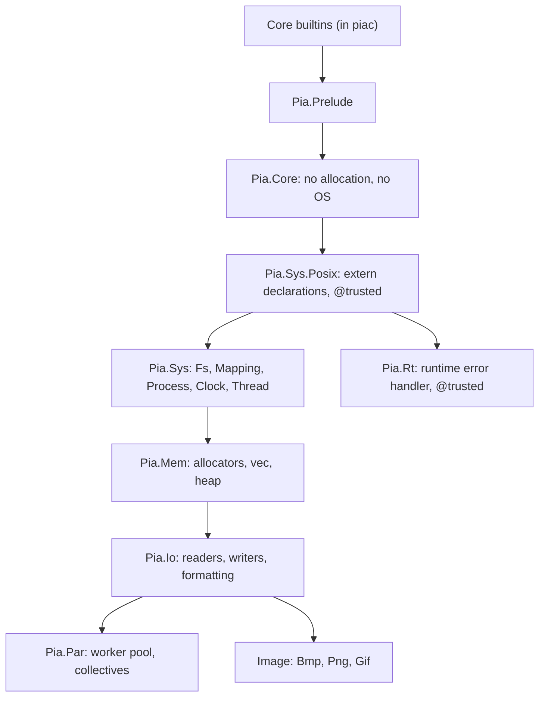

# The standard library and its core

Status: accepted design, 2026-11-21 ([ADR 0023](adr/0023-minimal-core-self-hosted-stdlib.md)). Nothing here is implemented yet. Code blocks show designed syntax.

This page answers one question: **what is the smallest set of things the compiler has to provide, so that everything else in the standard library can be written in Pia and proved like any other Pia code?**

It also covers two requirements that shape the answer:

- **The core calls POSIX directly** and wraps it in strongly typed, contract-constrained Pia functions. There is no C layer between a Pia program and the operating system.
- **Multiplication must be provable.** Today any `*` in a module widens the whole SMT encoding, and loop goals time out ([below](#multiplication-in-the-verifier)). A library full of `width * height` cannot live with that.

## Principle

A feature belongs in the core when one of these is true:

1. **Pia cannot express it.** It needs a machine instruction, an OS call, or memory that Pia has no way to describe. Examples: shifts, calling `read`, viewing a page that `mmap` returned.
2. **The verifier must know what it means.** The solver needs its semantics as axioms, not as a body to walk. Examples: `len`, `old`, wrapping arithmetic, the meaning of a buffer that has been freed.
3. **It shapes the language.** Other code cannot be written without it. Examples: modules, generics, sum types.

Everything else goes in the library, written in Pia, with contracts, and proved when the library builds. This is the same split as Rust's `core`, `alloc` and `std`. It is also how Zig and OCaml work: the library is ordinary code, and the compiler provides a short list of builtins (`@` builtins in Zig, `external` primitives in OCaml). What Pia adds is that every library function carries a contract the compiler has proved. That also asks things of the core that an unverified language does not need: specification functions and lemmas (see [Verification primitives](#5-verification-primitives)).

The prelude already works this way for operators ([ADR 0008](adr/0008-operators-via-metaprograms.md)). `+` is a metaprogram that expands to the core builtin `add`, and the builtin is what the verifier and codegen understand. The proposal extends that pattern to the rest of the library.

The rule from [ADR 0004](adr/0004-strongest-guarantee-by-default.md) applies throughout: the strongest guarantee is the default. The only things taken on trust are the compiler's builtins and the contracts of a short, audited list of POSIX functions. Each of those trusts is named in a proof certificate, so `piac` can print the trusted base of any program.

## What the core has today

| Area | Core today |
| --- | --- |
| Arithmetic builtins | `add` `sub` `mul` `div` `rem` `add_sat` `sub_sat`, with `@overflow(proof\|wrap\|saturate\|trap)` |
| Comparison and logic | `eq` `ne` `lt` `gt` `le` `ge`, `and` `or` `implies` `iff` |
| Buffers | `len`, indexing `xs.[i]`, fixed arrays `[T; n]`, slices `[T]` |
| Contracts | `requires` `ensures` `assert` `assume` `old` `forall` `exists` `invariant` `decreases` |
| Types | bounded integers, range types `int{lo..hi}`, `bool`, records, type aliases |
| Meta builtins | `map` `fold` `length` `fields` `name` `concat`, quotes and splices |
| Prelude | operator declarations, `fold_and`, `derive_eq`, held as a C++ string in `src/syntax/Prelude.cpp` |

That is enough for the edge detection demo (`examples/edges`), but not for a library. The demo shows the gaps directly: `main.c` reads and writes the BMP files and allocates the buffers, because Pia has no I/O and no allocation, and grayscale is `(r + 2g + b) / 4` rather than BT.601, because one `*` makes its loop goals time out. The gaps that block a library, roughly in order of how much they block:

- **No modules or imports.** A library cannot be imported, so every program would have to paste it in. This is milestone M8 ([ADR 0010](adr/0010-modules-interfaces-and-proof-certificates.md)).
- **No generics.** Every function is for one concrete type. This is M9 ([ADR 0009](adr/0009-generics-concepts-adapters.md)).
- **No sum types or `match`.** So there is no `option` or `result`, and no way to return an error.
- **No bitwise operators or shifts.** Hashing, checksums, bitsets, UTF-8 and the PNG codec in M13 all need them.
- **No memory allocation, and no calls to the outside world.** All memory comes from a C caller, and there is no I/O.
- **Multiplication defeats the solver** once loops are involved.
- **No calls inside contracts.** A call in a contract is an unknown value ([verifier.md](verifier.md#limits-of-v0)). So a library cannot state `ensures sorted xs`, or `ensures result = sum xs`. Spec functions and lemmas (#52) now lift this ([verifier.md](verifier.md#spec-functions-and-lemmas)).
- **No slicing `xs.[a .. b]`, no buffers of records, no constant arrays, no function values.**

## The proposed minimal core

The core is grouped by what each group unlocks in the library. **★** marks what the first useful library (`Pia.Core`, below) cannot do without.

### 1. Modules and the prelude as a module ★

- `module`, `interface`, `import` as already designed in M8. The library is a set of modules: `Pia.Core`, `Pia.Mem`, `Pia.Sys` and so on.
- The prelude becomes a real Pia module, `Pia.Prelude`, which every module imports implicitly. Today it is a C++ string. Moving it makes the operators ordinary library code, and lets the library be versioned with the compiler.
- Proof certificates ([ADR 0010](adr/0010-modules-interfaces-and-proof-certificates.md)) apply to the library like any other module. A program proved against `Pia.Core`'s interface keeps its proof until that interface changes. Certificates also list the trusted contracts a module depends on ([group 8](#8-posix-trusted-declarations-and-typed-wrappers)).

### 2. Integer primitives ★

New builtins, each one or two MLIR ops, with exact SMT semantics (`bvand`, `bvshl` and so on):

| Builtin | Meaning | Goal raised |
| --- | --- | --- |
| `band` `bor` `bxor` `bnot` | bitwise logic, exact on the two's-complement form of the integers (`bnot` on an unsigned type flips the bits of its storage width) | the result fits, in proof mode |
| `shl` `shr` | shifts: `a * 2^b` and `floor(a / 2^b)` | `0 <= b < bits t` (the `shift` goal), in every mode. `shl` in proof mode also proves no bits are lost |
| `rotl` `rotr`, `clz` `ctz` `popcount` `bswap` | bit counting, rotation and byte swap, through LLVM intrinsics | none |
| `widen e` | to a wider type of the same signedness | none |
| `narrow e` | narrowing conversion, the explicit form of what assignment does now | the value fits |
| `wrap_to t e`, `sat_to t e` | conversion with a stated overflow mode | none |
| `mul_wide a b` | the full product in a type twice as wide, `u32 -> u32 -> u64` | none |
| `bits` `from_bits` | reinterpret, once floats exist | none |

Their operators use C's symbols (Dean, 2026-11-21) and go in the prelude as metaprograms, like `+` today:

| Operator | Builtin | Precedence |
| --- | --- | --- |
| `~x` | `bnot` | prefix, binds like `-x` |
| `<<` `>>` | `shl` `shr` | 5.5, left (between `..` and `+`) |
| `&` | `band` | 6.5, left (between `+` and `*`) |
| `^` | `bxor` | 6.4, left |
| `\|` | `bor` | 6.3, left |

Unlike C, bitwise operators bind tighter than comparisons, so `x & mask = 0` means `(x & mask) = 0`. Precedence levels may have one decimal place for this. `~x` is built into the parser like `-x`, and stands for `bnot x`. Implemented in #48.

`|` is already a grammar token: it separates variants and match arms, and starts a refinement's predicate ([grammar.md](grammar.md)). So `|` means bitwise or only inside parentheses or brackets opened within the expression. At the top level of a match arm's body or a refinement it keeps its grammar meaning, and `| A -> (x | y)` needs the parentheses. `||` and `&&` stay logical, and `^`, `&`, `<<` and `>>` are free today.

Everything else about integers is library code: `min`, `max`, `clamp`, `abs`, `gcd`, `isqrt`, `ilog2`, checked or wrapping helpers, `is_power_of_two`, `align_up`, and byte-order reads such as `u32_be` (PNG is big-endian, BMP little-endian), each with a postcondition the verifier checks against the arithmetic definition.

### 3. Sum types and `match` ★

These are already designed (`let shape = type | Circle of f32 | ...`). Implementing variants and an exhaustive `match`, encoded as Z3 datatypes as [design.md](design.md#type-system) describes, unlocks `option`, `result`, `ordering`, and every API that can fail. Without them, the library can only report errors through out-parameters and flags. Implemented for non-generic variants with scalar or record payloads (#54), encoded as a tagged record rather than Z3 datatypes, since MLIR's `smt` dialect has none. Generic `option<T>` and `result t e` wait for generics, and buffer payloads for buffers in records.

### Errors and scope cleanup ★

Every API that can fail returns a `result`, so the library needs a way to pass errors on without writing a `match` at every call, and a way to clean up on every exit from a scope ([ADR 0028](adr/0028-error-propagation-and-cleanup.md)).

**Error sets.** `result t e` holds `Ok` of a `t`, or `Err` of an `e`, where `e` is a closed variant type or a union of them: `result [u8] (OutOfMemory | IoError)`. Error sets are part of a function's interface, as in Zig and Swift's typed throws, so a caller always knows the complete list. A `result` must be used: dropping one unexamined is a type error.

**`?` passes an error to the scope's handler.** `e?` is the `Ok` payload of `e`, or, for `Err x`, a jump to the nearest enclosing handler with `x`. A scope declares its handler with `handle`:

```ocaml
let load (m : borrowed general) (path : str) : result image LoadError =
  let f = open_read path? in            (* NoEntry | Denied | ... *)
  defer close f;
  let bytes = read_all m f? in          (* OutOfMemory | IoError *)
  decode_png m bytes?                   (* PngError *)
handle
| NoEntry | Denied -> Err (Missing path)
| OutOfMemory -> Err TooBig
| IoError -> Err Unreadable
| PngError p -> Err (BadImage p)
```

- **The handler covers a closed set.** The compiler computes the set of every error a `?` in the scope can produce, and the handler's arms must cover exactly that set: a missing case is an error, and so is a case that cannot happen. The verifier knows the `Ok` payload on the normal path and the `Err` value in the handler.
- **Without a handler, `?` returns the error** from the function, and the function's declared error set must include it. Calling a function adds its error set to the scope's, and nothing is inferred across an interface.
- `handle` attaches to a function body, a `let ... in` scope, or a loop body. It is one keyword, in Dean's style.
- **An arm knows only what holds where its errors are raised** (Dean, 2026-11-22). Each arm is checked and proved once per `?` that can reach it, so the arm for `decode_png`'s errors may use `bytes`, while the arm for `open_read`'s errors may not. `| PngError p ->` binds the payload, and `| e ->` or `| NoEntry as e ->` binds the whole error.
- Implemented (#84), with error sets: see [irgen.md](irgen.md#errors). Or-patterns in arms and a set converting to a larger set come next.

**Cleanup at scope end.** Two forms, both run in reverse order of registration on every exit from the scope: falling off the end, `?`, a handler's result, and a loop's next iteration.

- **`defer e`** registers `e` to run at scope end, as in Zig, Go and Swift. It is for one-off cleanup, such as `defer close f` above. Its scope is the rest of the sequence it starts. Implemented (#85): see [irgen.md](irgen.md#errors). `defer?` and `Drop` come next.
- **RAII through `Drop`.** A type with a `Drop` instance (a concept, ADR 0009) is dropped at the end of the scope that owns it, unless it was moved or freed first. Buffers, arenas, read-only file descriptors and mappings have one, so anything not freed explicitly is freed by its scope. `@derive(drop)` drops each field. Implemented, except `@derive(drop)` (#85): see [irgen.md](irgen.md#errors).
- **Cleanup cannot fail, suspend or lock.** `defer` bodies and `drop` have no error set, may not await, and may take no lock other than a top-level leaf lock, since cleanup also runs on exits from `lock` bodies ([ADR 0027](adr/0027-coroutines-and-race-freedom.md)). Freeing into `general` qualifies: its central lists are behind exactly such a lock. A resource whose cleanup can fail is `@linear` instead and must be consumed explicitly, so its error goes through `?` like any other.
- **Cleanup never shadows the error in flight** (Dean, 2026-11-21). The verifier raises a `cleanup` goal at each exit: the error that reaches the handler is the one the `?` raised. A release that can fail is written `defer? e`, with `e : result unit c`. Every cleanup still runs, and the scope's errors become `cleanup_error<e, c> = | Failed of e | Cleanup of list c | Both of { error : e; cleanup : list c }`, so a failed close on an error path is reported beside the original error, not instead of it. A `@linear` value whose consumption can fail may be live across a `?` only when a `defer?` consumes it.
- **Cleanup is proved.** Each exit's cleanup is walked by the verifier like ordinary code at that exit, so a `drop`'s preconditions are goals there.
- A trap does not run cleanup. It goes to `Pia.Rt`, which stops the process.
- **With concurrency** (ADR 0027): `?` never crosses a task or a `lock` closure. In a spawned task it ends the task, and the error comes back from `join`. In a `lock` body it leaves the body, releases the lock, and becomes the body's result. A structured `scope` that exits early first joins, or cancels and then joins, every child still running, and only then runs its own cleanup, because children may borrow from it. Cancellation is an explicit token: operations that take it return `Err Cancelled`, so a cancelled task leaves through `?` and its cleanup runs in its own frame.

### 4. Generics and concepts ★

M9 as designed: type parameters, concepts with laws, monomorphisation before verification. `Eq`, `Ord`, `Hash` and `Numeric` are then library code, and so are `@derive(ord, hash)`, written as metaprograms next to `derive_eq`.

There is a stopgap until M9 lands: metaprograms that stamp out one instance per type, for example `instantiate_sort u8`. The meta engine can already generate functions, so this works today. It gives a monomorphic library that can later be rewritten over generics without changing what callers write.

### 5. Verification primitives ★

This group has no counterpart in an unverified language's core. Without it, the library can be *safe* (in bounds, no overflow), but it cannot be *specified*. A `sort` could not promise that its result is sorted.

- **Specification functions.** `let spec sorted (xs : [i32]) : bool = forall (i in 1..len xs). xs.[i - 1] <= xs.[i]`. A spec function is pure, total and side-effect free. It may be used in contracts, and the verifier gives its definition to Z3: as a macro when it is not recursive, or as `define-fun-rec` with its `decreases` measure when it is. This removes the "calls inside contracts are unknown values" limit. Dafny, F* and SPARK (whose expression functions play this role) are built on the same idea.
- **Lemmas.** `let lemma sum_split (xs : [u8]) (k : usize) : unit requires k <= len xs ensures sum xs = sum_to xs k + sum_from xs k = ...`. A lemma is proved once, erased from code, and a call to it adds its postcondition at the call site, through the existing rule that a call is taken on its callee's contract. It is what makes proofs about loops, recursion and multiplication scale.
- **Ghost values**, possibly later. Locals and parameters that exist only in the proof, such as a model `seq<T>` of a vector's contents, erased by codegen like contracts are today. SPARK's formal containers use exactly this pattern: each container has a mathematical model, and its contracts are written against the model.
- **Permutation and multiset reasoning**, possibly later. `ensures permutation xs (old xs)` is the other half of a sort's specification. It can be a spec function over counts first, with a dedicated encoding only if Z3 struggles.

### 6. Buffers ★

- **Slicing** `xs.[a .. b]`, as a view with proved bounds. The library cannot split work, recurse on halves, or return part of a buffer without it. Implemented with `abort` (#50): `pia.slice` lowers to a strided memref view.
- **Constant data**: array literals and module-level constant arrays (`let crc_table : [u32; 256] = ...`), placed in read-only data. Many library algorithms are table driven. Implemented for integer literals (#50): `pia.const_array` lowers to a constant `memref.global`.
- **Buffers of records** in codegen, which the scalariser does not lower yet.

### 7. Linear resources and memory

Pia does not allocate. Two things fix that: one type rule, and allocation written in Pia over `mmap`.

**`@linear` types.** Pia already has `moved` parameters, which make a value dead in the caller after the call. A type marked `@linear` adds one rule to the type checker: a value of it must be consumed, by being passed as `moved` or returned, on every path out of its scope. A `@linear` type is for a resource whose cleanup can fail, such as a file opened for writing, whose `close` can report a lost write: it must be consumed explicitly, so the error is handled. A resource whose cleanup cannot fail, such as a read-only `fd`, a mapping or an arena, has a `Drop` instance instead, and is cleaned up at scope end if it is not freed first ([ADR 0028](adr/0028-error-propagation-and-cleanup.md)). Either way, using a value after it is closed is the existing `moved` rule. Implemented: see [irgen.md](irgen.md#bindings-and-mutation). This is the idea behind ATS's and Austral's resource types, kept to one attribute and no typestate ([ADR 0006](adr/0006-contracts-and-module-state.md)).

**The memory manager.** `Pia.Mem` is a memory manager written in Pia over `mmap`, with no garbage collector, now or later ([ADR 0026](adr/0026-memory-manager.md)). There is no `new` keyword: allocation is a call of a function in `Pia.Mem`, and every allocation can fail and must be handled where it is called. Every free is explicit, or happens at scope end through a cleanup handler ([ADR 0028](adr/0028-error-propagation-and-cleanup.md)), or comes from freeing the arena the memory lives in. A single global `malloc`/`free` is not enough. Different lifetimes want different allocators, and the verifier can prove more about a specialised allocator than about a general heap.

*Allocators are explicit values.* Library code never allocates from a hidden global. A function that allocates takes an allocator parameter, as in Zig:

```ocaml
let Allocator (a : type) : concept = sig
  let alloc  : (m : borrowed a) -> (t : type) -> (n : usize) -> result (borrowed(m) out mutable [t]) OutOfMemory
    ensures match result with
            | Ok buf -> len buf = n && fresh m buf          (* enough memory, disjoint from every live block *)
                        && aligned buf (max 16 (align_of t))  (* low 4 bits of every block address are free *)
            | Err OutOfMemory -> unchanged m               (* or a clean failure *)
  let free   : (m : borrowed a) -> (buf : moved [t]) -> unit
    requires owns m buf
end

let read_all (m : borrowed a) (f : fd) : result [u8] (OutOfMemory | IoError) where Allocator a =
  let buf = m.alloc u8 (size f)? in      (* `?` hands OutOfMemory to the caller *)
  ...
```

- An allocator is reached through a plain `borrowed` handle, so many containers can share one. Its state is module state that only `Pia.Mem` changes, and since an allocator that is not `shareable` stays in one task, sharing the handle is race-free.
- The result is `out`, so reading memory before writing it is a proof goal.
- **Every allocation can fail, and the failure must be handled at the call site.** `alloc` returns a `result`, a `result` cannot be ignored, and the caller either matches on it or passes the error on with `?` to the scope's handler ([ADR 0028](adr/0028-error-propagation-and-cleanup.md)). There is no trapping variant. A program that wants to stop on out of memory says so in its handler.
- **Enough memory, or fail.** The postcondition above is proved for every allocator: `Ok` means `n` elements, disjoint from every live block, and `Err OutOfMemory` means the allocator's state is unchanged. `fresh` and `unchanged` are spec functions over the allocator's ghost model of its live blocks.
- `free` takes the buffer `moved`, so use after free and double free are type errors, not proof goals. `owns m buf` is a ghost fact recorded when `m` handed out `buf`, so freeing into the wrong allocator is a proof goal.
- `main` gets the program's root allocator as an argument. Nothing else is global.

*The allocators.* Each is a `@linear` value built on a page source, and each states its invariants as module state, proved once in `Pia.Mem`:

| Allocator | Frees | Fits | Invariant proved |
| --- | --- | --- | --- |
| `pages` | `munmap` of whole mappings | the source for every other allocator; guard pages and huge-page hints | mappings are disjoint and page aligned |
| `fixed_buffer` | all at once | allocation over a caller's buffer, with no OS at all; usable from `Pia.Core` | the bump pointer stays inside the buffer |
| `arena` | all at once (`reset`, or consuming the arena) | pipelines and per-request or per-frame work, like the demos | handed-out slices are disjoint and inside the arena's chunks |
| `scratch` | last in, first out, back to a `mark` | temporaries inside a function or a loop iteration | frees happen in reverse order of allocation |
| `pool<T>` | one object at a time, O(1) | many objects of one type: graph nodes, tasks, coroutine frames | the free list and the live set partition the slab |
| `general` | one buffer at a time | lifetimes that don't nest: TCMalloc-style size classes (below) | every block is in exactly one size class, and free or live |

*The general allocator is TCMalloc-style.* Requests are rounded up to one of a fixed table of size classes (about 8 bytes to 256 KiB, spaced so the rounding waste stays under 12.5%), and larger ones go straight to the page heap. Three tiers keep the common path short:

1. **A per-task cache** of free lists, one list per size class. It is a `@linear` handle moved into a task, worker or coroutine scope, so the fast path takes no lock and no atomic.
2. **Central free lists**, one per size class, which refill and drain the caches in batches. They are behind the allocator's one lock, a top-level leaf lock that never suspends.
3. **A page heap** of spans (runs of pages from `pages`), each span carved into blocks of one size class.

All free lists live inside `Pia.Mem`, and the proof covers them. Every block on a free list is free, lies inside a span of its class, and overlaps no live block. A cache, central list and page heap together hold each block exactly once. And `alloc` is total: it returns a block of the right class from the cache, or refills from the central list, or carves a span from the page heap, or returns `Err OutOfMemory` when `mmap` fails, and in that last case nothing has changed.

*Arenas for tasks, fibers and coroutines.* Every task, `spread` worker and coroutine scope gets an arena of its own by default, alongside its `general` cache. Its frame data and temporaries come from it, and the arena is freed when the task ends. A task that needs memory to outlive it allocates from an allocator its caller passed in.

Containers (`vec`, `string`, `hash_map`, the binary heap that priority-flood needs) take an allocator as a parameter, as C++'s `pmr` containers do, so the same `vec` can live in an arena or in a pool. They are the first place where specification functions and ghost models (group 5) pay off: `push` ensures `model result = append (model old) x`.

*Lifetimes are proved, not collected.* Two rules in Sema, with no lifetime syntax in ordinary code:

1. **A borrow cannot outlive its lender.** `borrowed(m) [t]` says the slice is borrowed from `m`. While it is live, `m` cannot be moved, so it cannot be reset, freed or sent to another task. Borrows are lexical: they end at the end of the scope that holds them.
2. **Regions can be scoped.** `with_arena n (let (a) => body)` makes an arena, runs `body`, and frees the arena. The arena's type is fresh to `body`, and `body`'s result type cannot mention it, so nothing allocated in the arena can escape. This is Haskell's `runST` trick, and the region idea from Cyclone and the ML Kit, without region inference.

Leaks are ruled out by cleanup at scope end. Allocators and the buffers they hand out have a `Drop` instance ([ADR 0028](adr/0028-error-propagation-and-cleanup.md)): a buffer from `general` or a `pool` that is not freed explicitly is freed when its scope ends, on every exit including `?`, and so is an arena. A buffer from an arena needs nothing, because freeing the arena frees it. So proved code cannot leak, double free, or use after free, and none of that costs anything at run time beyond the frees themselves.

*Threads and coroutines.* An allocator is a value, not a global, so concurrency needs no allocator locks by default. This follows the coroutine design in [ADR 0027](adr/0027-coroutines-and-race-freedom.md), which makes coroutines stackless:

- A task, worker or coroutine scope gets its own allocator, `moved` to it. `spread` gives each tile's worker its own arena by default, and frees it when the worker joins. A `@linear` allocator is `sendable` (it can move to another thread) but not `shareable`.
- Coroutine frames have a size known at compile time, and come from the allocator that the enclosing task scope was given, usually a `pool` of frames. Stackless coroutines need no green-thread stacks. The `pool` of fixed-size, guard-paged stacks is only for OS worker threads, so that a stack overflow faults into `Pia.Rt` instead of corrupting memory.
- A coroutine may hold borrows from an arena across a suspension point, as long as the arena's region encloses the coroutine. Rule 1 enforces that the arena outlives every suspended borrow.
- `general` is shareable by construction: its per-task caches are moved, and only its central lists are shared. `shared<a>` wraps any other allocator for use from several threads, in the same way. Both are `shareable`, it is the only allocator with synchronisation, and choosing it is explicit. The lock that refills its caches is a leaf lock at the top lock level, since it can be taken while user locks are held, and it never suspends. So allocating inside a `lock` body is allowed.

*With sanitizers*, every allocator poisons the memory it hasn't handed out and the blocks it has freed, so foreign code that strays into them is reported ([sanitizers](#sanitizers-compiler-rt)).

Prior art: Zig's explicit allocators, Odin's and Jai's allocator contexts, C++'s `std::pmr`, Rust's `bumpalo` and allocator API, mimalloc's sharded free lists, the Linux slab allocator, and Cyclone and the ML Kit for regions.

#### The litmus test: a proved growable array

The memory design is accepted when this works end to end: a dynamically growing array over explicit heap allocation, with its bounds, capacity, initialisation and freedom from leaks all proved. It is a sketch in designed syntax. `Pia.Mem.Vec` is the first target of the implementation.

```ocaml
(* Pia.Mem.Vec *)
let vec = let (t : type) (a : type) => type {
  heap : borrowed a;            (* where buf came from: the vec cannot outlive its allocator *)
  buf  : moved mutable [t];     (* owned; len buf is the capacity *)
  len  : usize;
} where Allocator a
    && len <= len buf
    && owns heap buf            (* buf was handed out by heap, and not freed *)
    && written buf 0 len        (* the first len elements are initialised *)

(* What the vec means: its elements, as a sequence. *)
let spec model (v : vec t a) : seq t = take v.len v.buf

let empty (heap : borrowed a) : vec t a
  ensures model result = []
= { heap = heap; buf = Pia.Mem.empty_slice t; len = 0 }

let get (v : vec t a) (i : usize) : t
  requires i < v.len
  ensures result = nth (model v) i
= v.buf.[i]                                    (* in bounds: i < len <= len buf *)

(* Doubles the capacity, or fails and leaves the vec exactly as it was. *)
let grow (v : inout mutable vec t a) : result unit OutOfMemory
  ensures match result with
          | Ok () -> len v.buf > v.len && model v = old (model v)
          | Err OutOfMemory -> v = old v
=
  let cap = len v.buf in
  if cap >= max_elems t then Err OutOfMemory   (* doubling would overflow the address space *)
  else
    let cap' = if cap = 0 then 4 else min (cap + cap) (max_elems t) in
    let buf' = Pia.Mem.alloc v.heap t cap'? in  (* on failure, nothing has changed yet *)
    copy v.buf.[0 .. v.len] buf'.[0 .. v.len];
    let old_buf = replace v.buf buf' in
    Pia.Mem.free v.heap old_buf;               (* explicit free of the old buffer *)
    Ok ()

let push (v : inout mutable vec t a) (x : moved t) : result unit OutOfMemory
  ensures match result with
          | Ok () -> model v = append (old (model v)) x
          | Err OutOfMemory -> model v = old (model v)
=
  if v.len = len v.buf then grow v?;
  v.buf.[v.len] <- x;                          (* in bounds: grow made room *)
  v.len <- v.len + 1;
  Ok ()

let pop (v : inout mutable vec t a) : option t
  ensures match result with
          | Some x -> old (model v) = append (model v) x
          | None -> old v.len = 0
= ...

(* RAII: a vec that is not freed explicitly is dropped at scope end. *)
let drop (v : moved vec t a) : unit = drop_each v.buf.[0 .. v.len]; Pia.Mem.free v.heap v.buf
let drop_vec : adapter Drop (vec t a) = { drop = drop }
```

And a caller, where every allocation is handled and nothing can leak:

```ocaml
let squares (heap : borrowed general) (n : u32) : result (vec u64 general) OutOfMemory
  ensures match result with Ok v -> len (model v) = n | Err _ -> true
=
  let v = Vec.empty heap in
  for i in 0..n invariant len (model v) = i do
    Vec.push v (mul_wide i i)?                (* on failure: v is dropped, and the error returned *)
  done;
  Ok v                                         (* moved out, so not dropped here *)
```

What has to be proved, and which part of the design proves it:

| Property | Proved by |
| --- | --- |
| Every index in bounds | the type's `where`: `len <= len buf`, and `grow`'s postcondition |
| No read of uninitialised memory | `alloc`'s `out` result, and `written buf 0 len` in the invariant |
| Capacity arithmetic cannot overflow | `max_elems t`, and the ladder for `cap + cap` ([multiplication](#multiplication-in-the-verifier)) |
| Growth gives enough memory or fails cleanly | `alloc`'s postcondition, and `grow` touching nothing before its `?` |
| Elements survive growth | `copy`'s postcondition, so `model v = old (model v)` |
| No double free, no use after free | `free` and `replace` take `buf` `moved` |
| No leak | `Drop` on `vec` at scope end, on every exit including `?` |
| Freed into the right allocator | the ghost `owns heap buf` in the invariant |
| The vec cannot outlive its allocator | `heap : borrowed a`, by the borrow rule |

The sketch needs, from the core: generics, record invariants (`where` on a record type), spec functions with `seq`, slicing, `?`, `Drop`, `moved` fields with `replace`, and the `Pia.Mem` allocators. That makes it a good test of all of them together.

#### The second test: free-list reuse

A memory manager is only useful if freed memory comes back. So the second acceptance test is reuse: a block that was freed is handed out again, and the proof shows the new owner cannot alias any live object, cannot be reached through a stale reference, and cannot read the old owner's data.

```ocaml
let reuse (heap : borrowed general) : result unit OutOfMemory =
  let nodes = Pool.create heap node 1024? in   (* a pool<node>, dropped at scope end *)
  let a = Pool.take nodes? in                  (* a box<node>: one slot, owned *)
  a.value <- 1;
  let r = a.value in                           (* a copy, not a reference *)
  Pool.give nodes a;                           (* a is moved: dead from here *)
  let b = Pool.take nodes? in                  (* may be a's old slot *)
  b.value <- 2;                                (* b is out: written before it is read *)
  assert r = 1;                                (* the copy is unaffected *)
  Pool.give nodes b;
  Ok ()
```

| Property | Proved by |
| --- | --- |
| A reused block aliases no live object | the allocator's invariant that free and live blocks are disjoint: `give` moves the block from live to free, `take` moves it back, and `fresh` in `alloc`'s postcondition |
| No stale owner | `give` and `free` take the block `moved`, so the old name is dead (`a` above is a type error after `give`) |
| No stale borrow | the borrow rule: a block cannot be moved while something borrowed from it is live, so every borrow of `a` ends before `give` |
| No stale raw address | `addr` exists only in `@trusted` modules. In foreign code, ASan's quarantine delays reuse so a dangling C pointer is reported ([sanitizers](#sanitizers-compiler-rt)) |
| The new owner cannot read the old data | the reused block comes back `out`, so its contents are unknown to the verifier and must be written before they are read. `alloc_zeroed` is there for code that wants zeroes |
| Each block is in exactly one place | the free list, the live set, a per-task cache and the central list partition every span, and each move between them keeps the partition |
| Reuse cannot cross allocators | the ghost `owns` fact, so a block freed into one pool or size class is only handed out by it |

*Free lists are side metadata, not pointers in freed blocks.* TCMalloc threads its free lists through the freed blocks themselves. Doing that in Pia would mean writing through `addr`, and `Pia.Mem` would become trusted. Instead, each span keeps its free list as a stack of slot indices (`[u16]`, two bytes per slot) beside the blocks. Pushing and popping it are ordinary bounds-checked array operations, so the reuse invariants above are proved, and `Pia.Mem` stays out of the trusted base. Moving batches between a per-task cache and the central list happens under the central lists' leaf lock, so there is no lock-free ABA problem to prove.

### 8. POSIX: trusted declarations and typed wrappers

The core calls POSIX directly. On macOS that means libSystem, not raw system call numbers: Apple changes the syscall ABI between releases and supports only calls through libSystem, which is why Go moved to libSystem on macOS in Go 1.12. So a Pia program links against libSystem like any C program, and nothing between the two is written in C.

**FFI: foreign functions with explicit contracts.** `extern "symbol"` as a function body declares a function with the C calling convention, implemented outside Pia. It is an ordinary identifier that the core gives meaning to, like `old` and `result`, so `let` stays the only binding form ([ADR 0002](adr/0002-single-let-binding-form.md)). The declaration's parameter types, modifiers, result type and contract are Pia's:

```ocaml
let crc32_z (crc : u32) (buf : [u8]) (n : usize) : u32
  requires n <= len buf
  = extern "crc32_z"                              (* zlib; reads n bytes, writes nothing *)
```

Any module may declare foreign functions, for its own C libraries as well as POSIX. The rules:

- **An explicit contract is required to call it normally.** A contract is explicit when the declaration has at least one `requires` or `ensures` clause. `ensures true` counts: it says on purpose that nothing more is promised. Parameter modifiers carry much of an FFI contract, and their defaults are promises too: a plain `[u8]` parameter is `borrowed in fixed`, so the function only reads the buffer and keeps no pointer to it.
- **The contract is trusted, not proved.** At each call, its `requires` is a proof goal like any other, and its `ensures` is assumed. Each contracted foreign function is a trusted item in its module's certificate.
- **A foreign function without an explicit contract can only be called as `unsafe f x`.** Writing `unsafe` is the caller's statement that it has checked the call by hand. The verifier assumes nothing about the result beyond its type's range, and every buffer passed to it is treated as written with unknown contents. Each `unsafe` call site, by symbol and source location, is a trusted item in the certificate. Calling such a function without `unsafe` is a compile error that suggests writing the contract.
- **`unsafe` is not a way around proof goals.** An `unsafe` call still has its arguments checked against their types, and every goal around it is proved as usual. It only marks that the callee's behaviour is taken on trust.

`unsafe` is a core form, like `extern`, not a block: it marks one call, so the trusted surface stays as small as the call. Rust's `unsafe` blocks and Verus's `assume_specification` are the prior art. Pia's version is narrower than Rust's, since a contracted foreign call needs no `unsafe` at all.

**Raw addresses.** `addr` is a raw machine address. It has no arithmetic and cannot be dereferenced. `view (a : addr) (n : usize) : [T]` turns an address into a slice, and `addr_of (xs : [T]) : addr` goes the other way. Both are trusted, so they and `assume` may only be used in a module marked `@trusted`. `Pia.Sys.Posix` and `Pia.Rt` are the only trusted modules in the library.

**`Pia.Sys.Posix` declares, the rest of `Pia.Sys` proves.** The trusted contracts are deliberately weak. They say only what POSIX guarantees, and each cites its manual page:

```ocaml
(* Pia.Sys.Posix, @trusted *)
let read (fd : i32) (buf : out mutable [u8]) (n : usize) : isize
  requires n <= len buf
  ensures result >= -1 && result <= n
  ensures result >= 0 ==> written buf 0 result      (* read(2): no more bytes than it returns *)
  = extern "read"
```

`read` returns at most `n`, or `-1`, and writes no more than it returns. It never says what a file contains. Every stronger claim is something the untrusted layer above has to prove. That layer turns integers and errno into types:

```ocaml
(* Pia.Sys.Fs, fully proved *)
let errno = type | Again | BadFd | Interrupted | Invalid | IoError | NoSpace | NoEntry | Denied | Other of i32
let fd = type { raw : i32 } @linear where raw >= 0           (* only built from a successful open *)

let open_read (path : str) : result fd = ...
let close (f : moved fd) : result unit = ...
let read_some (f : fd) (buf : out mutable [u8]) : result usize
  ensures match result with Ok n -> n <= len buf && written buf 0 n | Err _ -> true
  = ...
let write_all (f : fd) (buf : [u8]) : result unit           (* loops over write, retrying Interrupted *)
  = ...
```

`Err` carries a decoded `errno`, never a sentinel, and `match` must handle it. `raw` is not exported, so only `Pia.Sys` can make or unwrap an `fd`. Forgetting `close` is a type error. `errno` itself is `*__error()` on macOS, which `Pia.Sys.Posix` reads through `addr`, so it is a few lines of trusted Pia rather than a C helper.

The first set of declarations, enough for files, memory, time, threads and the demos:

| Group | libSystem functions | Wrapped in |
| --- | --- | --- |
| Files | `open close read write pread pwrite lseek fstat ftruncate fsync unlink` | `Pia.Sys.Fs`, then `Pia.Io` readers and writers |
| Memory | `mmap munmap madvise` | `Pia.Sys.Mapping` (a `@linear` region of pages), then `Pia.Mem` |
| Process | `exit getpid getenv`, and `argc`/`argv` | `Pia.Sys.Process` |
| Time | `clock_gettime nanosleep` | `Pia.Sys.Clock`: a monotonic `instant` and ordered `duration` |
| Threads | `pthread_create pthread_join`, `pthread_mutex_*`, `pthread_cond_*`, `sysctlbyname` for the core count | `Pia.Sys.Thread`: `spawn` takes a `moved` closure and returns a `@linear` handle that `join` consumes |
| Errors | `__error` | `Pia.Sys.Errno` |

**`main` and `abort`.** `let main (args : [str]) : u8` is a symbol Pia can export. A small entry function in `Pia.Sys.Process` builds `args` from `argv`, calls `main`, and passes the result to `exit`. So the edge demo's `main.c` becomes Pia. `abort` has the precondition `requires false` in proof mode, so every call to it is a proof that it cannot happen, or a visible `--allow-unproved`.

**Keeping the trusted base honest.** Each trusted declaration has a test that calls it on macOS and checks its contract's claims at run time, so a wrong trust shows up as a failing test rather than an unsound proof. Each module's proof certificate lists its own trusted items: contracted foreign functions, `unsafe` call sites, `assume`s and goals accepted with `--allow-unproved`, each with a hash of what is trusted. It does not copy its dependencies' items. The transitive trusted base of a program is computed by walking the certificates at link time, and `piac --trust-report` prints it. That way a dependency that swaps a proved body for an `assume`, without changing its interface, leaves importers' proofs valid (assume-guarantee) but still shows up in the report. The certificate format is [ADR 0024](adr/0024-published-proof-certificates.md)'s ([abi.md](abi.md)).

### 9. Runtime errors

Most failures are ruled out at compile time, but a few happen at run time by design: `@overflow(trap)`, `abort` reached through `--allow-unproved`, and faults inside foreign code (`SIGSEGV`, `SIGBUS`, `SIGILL`, `SIGFPE`). All of them go to one runtime error handler in `Pia.Rt`, written in Pia.

- **One entry point.** Codegen lowers every trap to a call of `pia_trap (kind, site)`, where `site` indexes a table of source locations the compiler emits into the binary. So a trap reports its Pia file, line and column, and what failed ("overflow in `a + b`, `@overflow(trap)`"), even in a binary without debug info.
- **Signals.** At start-up, `Pia.Rt` installs handlers with `sigaction` on an alternate signal stack (`sigaltstack`), so a stack overflow or a fault in foreign code also reaches the handler.
- **Stack traces.** The handler walks the frame-pointer chain, which arm64 macOS always keeps, and symbolises each return address with `dladdr`. When debug info is available (`piac -g` emits DWARF, and a `.dSYM` sits beside the binary), it adds file and line for each frame. Without it, it prints symbol names and offsets.
- **Debug info.** It also prints the trap kind, the faulting address for a signal, the thread, and for `unsafe` sites, the foreign symbol that was being called.
- **Safe in a signal handler.** The handler allocates nothing and writes with `write(2)` to standard error only, so it is async-signal-safe. It then exits with status 134, as `abort` would.
- **Replaceable.** A program can install its own handler with `Pia.Rt.on_trap`, for example to flush a log first. The default stays the strong one: print everything, then stop.

`Pia.Rt` is trusted, since it reads frames and signal contexts through `addr`, so its items appear in every program's trust report. The prior art is Rust's panic handler and `RUST_BACKTRACE`, and Go's runtime traceback on a fatal signal.

#### Sanitizers (compiler-rt)

Proved Pia code cannot overflow, index out of bounds, use freed memory or race, so sanitizers are not how Pia finds its own bugs. They earn their place at the edges of the proof, where the verifier takes something on trust ([ADR 0025](adr/0025-sanitizers.md)):

- **Foreign code** behind `extern` and `unsafe`, which can corrupt Pia memory, free it, or race with Pia threads.
- **Trusted contracts.** A wrong `extern` contract or `assume` makes a proof unsound without any failing goal. Run-time checks are the only way to catch it.
- **The trusted Pia modules**, `Pia.Sys.Posix` and `Pia.Rt`, which use `addr`.
- **The verifier itself.** A build that instruments everything and still finds nothing is evidence that the verifier, IRGen and codegen agree. A sanitizer report in proved code is a compiler bug.

**What piac emits.** `piac --sanitize=<list>` adds instrumentation through LLVM's own passes, so Pia and C code in one binary share one sanitizer runtime and one report format:

| Sanitizer | How piac emits it | Pia-specific part |
| --- | --- | --- |
| `address` (ASan) | `sanitize_address` on functions, then LLVM's `AddressSanitizerPass` | `Pia.Mem` poisons arena memory that has not been handed out, and freed buffers, with `__asan_poison_memory_region`, since ASan does not know about memory from `mmap` |
| `thread` (TSan) | `sanitize_thread`, then `ThreadSanitizerPass`; atomics are instrumented by the pass | the worker pool behind `spread` uses libSystem pthreads, which TSan intercepts, so it needs no annotations |
| `undefined` (UBSan) | LLVM has no UBSan pass; in clang it is front-end checks. Pia's equivalent is its goals | every goal that is not proved (skipped, or accepted with `--allow-unproved`) becomes a run-time check |
| `contracts` (Pia only) | checks after each call | the `ensures` of every foreign function and every `assume` is checked at run time, so a wrong trust fails loudly |

Other sanitizers wait for a need: MemorySanitizer and HWASan do not support macOS on arm64, LeakSanitizer comes with ASan where the platform supports it, and libFuzzer (`--sanitize=fuzzer`) is the natural next step for fuzzing the trusted boundary and the image decoders. ASan and TSan cannot be combined, and piac says so.

**Proved accesses are not instrumented by default.** A load whose bounds goal was proved gets LLVM's `nosanitize` metadata, so ASan's cost falls on the trust boundary: buffers passed to foreign functions, slices made by `view`, and arena bookkeeping. `--sanitize-proved` instruments every access too, which is the build that checks the verifier. TSan always instruments everything, because a race needs both sides instrumented and the other side may be C.

**With `Pia.Rt`.** A sanitizer runtime installs its own fatal-signal handlers and prints its own report. In a sanitized build, `Pia.Rt` does not install signal handlers, and so does not fight the runtime for `SIGSEGV`. It registers `__sanitizer_set_death_callback`, so that after the sanitizer's report it adds the Pia view: the trap site's Pia location and, for an `unsafe` or foreign call, the symbol being called. A Pia trap (`pia_trap`) in a sanitized build prints its stack with `__sanitizer_print_stack_trace`, so every report in one run looks the same. Both symbolise through DWARF, so sanitized builds also pass `-g`.

**The runtime libraries.** compiler-rt's sanitizer runtimes are versioned with the instrumentation (`__asan_version_mismatch_check_vN`), so they must come from the same LLVM that piac links. They are built from the pinned `llvm-project` with `rules_foreign_cc` and CMake, as Z3 is, and cached. Xcode's runtimes (`libclang_rt.asan_osx_dynamic.dylib`) are a fallback only when their version matches.

**Bazel.** Sanitizers follow the C++ toolchain's features, so one flag sanitizes the C and the Pia in a target together:

```
# .bazelrc
build:asan --features=asan --copt=-fno-omit-frame-pointer --strip=never
build:tsan --features=tsan
build:ubsan --features=ubsan
build:contracts --//tools/piac:sanitize=contracts
```

`pia_object` reads `ctx.features` and passes the matching `--sanitize` to piac. `contracts` has no C++ feature, so it is a Pia build setting that adds to whatever the features say. `bazel test --config=asan //...` runs the suite sanitized. In CI, `asan` and `tsan` run on the macOS runner beside the plain build, at first on main only, since each one builds LLVM's runtimes and doubles the test time.

### 10. SIMD, floats and atomics

These come with milestones M10 to M12, but they are core builtins, so they are listed here.

- **Floats (M11)**: `fadd fsub fmul fdiv fneg fsqrt fma fabs fmin fmax`, comparisons, `ftoi` (with a range goal), `itof`, `is_nan`, `is_inf`, and the three reassociation choices from [ADR 0012](adr/0012-floating-point-reassociation.md). Elementary functions (`exp`, `log`, `sin`, `pow`) are Pia in `Pia.Math`, never libm: range reduction and polynomials, with error bounds (in ulps or absolute) proved in their contracts. Only the sediment colour map needs them at first.
- **`vec<T, k>` (M10)**: `splat`, `lane` and `with_lane` (lane index proved), `vload xs i` and `vstore xs i v` (with `i + k <= len xs` proved), every integer and float builtin applied lane-wise with the same overflow modes, comparisons and `vselect`, constant `shuffle`, `vwiden_lo`/`vwiden_hi`/`vnarrow`, and horizontal `vreduce_add`/`vreduce_max`. They lower to MLIR's `vector` dialect, and to `arm_neon` where a pattern needs it. The verifier models a vector as `k` values.
- **Atomics (M12)**: `atomic_load atomic_store atomic_swap atomic_cas atomic_add atomic_sub atomic_and atomic_or fence` on an `atomic<T>` cell, each with a memory order (`relaxed acquire release acq_rel seq_cst`), lowering to LLVM atomics and so to `ldar`, `stlr`, `ldadd` and `cas` on arm64.

**Concurrency is then library code.** The worker pool behind `spread` is Pia in `Pia.Par`, over `Pia.Sys.Thread` and the atomics: a fixed set of threads, a work queue and a barrier. The collectives `scatter`, `gather`, `halo_exchange` and `all_reduce` are library metaprograms, as [ADR 0014](adr/0014-concurrency-model.md) already says. Race freedom stays in ownership, since tiles are `moved` to workers. The pool's own invariants (each task runs once, the barrier releases only when every worker arrives) are module-state contracts for the model checker pass. GPU placement ([ADR 0015](adr/0015-device-placement.md)) lowers through MLIR's `gpu` dialect to Metal. Metal's host API is Objective-C, not POSIX, so it is a separate trusted module later, outside this minimal core.

### 11. Metaprogram builtins

The interpreter has `map fold length fields name concat` ([meta.md](meta.md)), and ADR 0029 adds `kind`, `fail` (stop expansion with an error) and the comment builtins. Derives in the library need a few more, all read-only questions about types:

| Builtin | Answer |
| --- | --- |
| `field_type t f` | the type of field `f` of record `t` |
| `variants t` | the constructors of a variant type, with their payload types |
| `type_kind t` | `"record"`, `"variant"`, `"int"`, `"float"`, `"array"`, `"slice"` or `"vec"` (`kind`, from [ADR 0029](adr/0029-comments-as-syntax-and-literate-pia.md), is the kind of a syntax value) |
| `size_of t`, `align_of t` | layout, as codegen will lay it out |
| `int_bounds t` | the bounds of an integer or range type |
| `attrs x` | the attributes on an item or field, with their arguments |
| `nth` `zip` `range` | list helpers the library would otherwise write recursively |

With these, `@derive(ord)`, `@derive(hash)`, `@derive(serialise)` and `@derive(deserialise)` are library metaprograms. A PNG chunk header can be declared as a record and read by a derived, bounds-proved reader.

### 12. Later

- **Function values and closures**: `map`, `fold` and comparator-based `sort` over function values. Until then, generics plus concept instances (`Ord t`) cover most needs, which is also what lets them monomorphise and vectorise.

## Multiplication in the verifier

Today every integer in a module is a 68-bit bit-vector, or 132-bit if the module multiplies anywhere ([verifier.md](verifier.md#encoding)). So one `*` makes every goal in the module wider, and loop-nest bounds goals then time out. This is a verifier change rather than a builtin, but the library cannot be written until it is done, so it is part of the core. The design is a ladder, cheapest first. Each step is tried with a short timeout before the next.

1. **Width per goal, not per module.** Each goal's width is computed from the ops it contains and the intervals of their operands. A goal with no multiplication stays at 68 bits however many `*` the module has elsewhere. This alone should fix the edge demo's timeouts.
2. **Multiplication by a constant is linear.** `3 * i` is encoded as shifts and adds, and an affine goal goes to the Presburger stage ([ADR 0020](adr/0020-presburger-for-affine-goals.md)).
3. **Intervals first.** If interval analysis bounds both operands, it bounds the product, and the goal is settled without Z3, as for addition today.
4. **Opaque products and lemmas.** A product of two variables is encoded as an uninterpreted function with its basic facts: zero, one, commutativity, sign, and monotonicity in each argument within the operands' ranges. Goals that need more call a lemma from `Pia.Core.Arith` (`mul_le_mul`, `div_mul_le`, `mul_div_cancel`, `index_2d_lt`), which are ordinary [lemmas](#5-verification-primitives) proved once. Most bounds goals in image code, such as `y * w + x < w * h` given `y < h` and `x < w`, are settled here.
5. **Exact nonlinear arithmetic, in a query of its own.** Only when the steps above fail does the goal get the exact product, at the width it needs, in a separate query. Bit-vectors and Z3's nonlinear integer solver run as a portfolio, and the first answer wins.

Verus does the same: nonlinear facts are kept out of ordinary queries, proved in small `by (nonlinear_arith)` queries, and packaged as `vstd::arithmetic` lemmas. Dafny's standard library does it with nonlinear lemmas and an option that turns nonlinear reasoning off in ordinary queries. A goal that still times out is reported with the step it reached and a suggestion: a lemma that would close it, or an `assert` that splits it. Proof decomposition stays explicit and visible in the source. The same ladder applies to `/` and `%`, which today get special-case facts for non-negative operands.

## The library, layer by layer



| Layer | Needs from the core | Contents (all Pia) |
| --- | --- | --- |
| `Pia.Prelude` | modules | operators, `derive_eq`, later `derive_ord` and `derive_hash` |
| `Pia.Core` | groups 1 to 6 | `option` `result` `ordering`; `Eq` `Ord` `Hash` `Numeric`; integer utilities and `Arith` lemmas; slice algorithms (`fill` `copy` `equal` `find` `reverse` `rotate` `binary_search` `sort` `partition`); fixed-capacity containers (`array_vec`, `bitset`, `ring`); `crc32` `adler32` `fnv`; UTF-8 validation; formatting integers into a buffer and parsing them |
| `Pia.Sys.Posix` | group 8 | the trusted libSystem declarations, and nothing else |
| `Pia.Rt` | groups 8 and 9 | the trap entry point, signal handlers, stack traces |
| `Pia.Sys` | groups 7 and 8 | `fd`, `mapping`, `errno`, `args`, `exit`, clocks, threads: POSIX in strong types, fully proved |
| `Pia.Mem` | group 7 | the `Allocator` concept; `pages` `fixed_buffer` `arena` `scratch` `pool` `general` `shared`; `vec`, `string`, `hash_map`, `heap` |
| `Pia.Io` | `Pia.Sys`, `Pia.Mem` | `reader` and `writer` concepts with bounds-proved reads, buffered file I/O, `str` as `[u8]` refined to valid UTF-8, printing |
| `Pia.Math` | floats | elementary functions with error bounds |
| `Pia.Par` | atomics, threads | the `spread` worker pool, collectives |
| `Image.Bmp`, `Image.Png`, `Image.Gif` | all of the above | BMP first, to replace the demo's `main.c`; then zlib inflate and deflate, PNG unfiltering, GIF LZW (M13) |

`Pia.Core` needs no allocator and no OS, like Rust's `core`, so it can run anywhere the compiler targets, including a GPU kernel later on.

Every function in every layer has a contract that is proved when the library builds. Proved means at least the strongest-guarantee defaults (no overflow, in bounds, terminates). Where specification functions allow, it also means functional correctness: `sort` returns a sorted permutation of its input, `binary_search` finds the element if it is there, and `write_all` writes every byte or returns `Err`. The codecs are good stress tests: inflate's back-references need `distance <= bytes written so far`, Huffman decoding needs bounded table indices, LZW needs the code table to stay within 4096 entries, and the decoded image's length is proved against the header's `width * height * channels`, which is why multiplication comes first.

## Suggested order

Each step unlocks a usable slice of the library, and the order follows the roadmap:

1. **Per-goal widths and the multiplication ladder.** No language change, and it unblocks the edge demo's BT.601 grayscale today.
2. **Integer primitives, slicing, constant arrays, `abort`.** Small compiler changes, and enough to write checksums, bit utilities and slice algorithms as a single-file library.
3. **Spec functions and lemmas**, with `Pia.Core.Arith`. So the library can be specified as it is written, and not retrofitted later.
4. **Sum types and `match`, then `?`, `handle`, `defer` and `Drop`.** `option`, `result`, and fallible APIs.
5. **`extern`, `unsafe`, `addr`, `@trusted`, `@linear`, `main`, `--trust-report`, and the runtime error handler.** `Pia.Sys.Posix`, `Pia.Sys.Fs` and `Pia.Rt`. A Pia program can read and write files without C. Until modules land, `piac` takes several source files compiled as one program, so this does not wait for M8.
6. **Modules (M8)**, with the prelude moved into Pia. The library becomes importable, and the trusted-module boundary becomes a module boundary.
7. **`Pia.Mem` and `Image.Bmp`.** The edge demo drops `main.c`.
8. **Generics (M9).** Rewrite `Pia.Core` generically. The metaprogram-instantiated versions show what the generic versions must match.
9. **Floats (M11), `vec` (M10), atomics and `Pia.Par` (M12)**, then the PNG and GIF codecs (M13) for the flagship demo.

Steps 1 to 5 need neither M8 nor M9, so they can start now, alongside M8.

## Prior art

| System | What Pia takes from it |
| --- | --- |
| Rust `core` / `alloc` / `std`, and the `libc` crate | the split between what needs no OS, what needs an allocator, and what needs the OS |
| Zig | explicit allocators; on macOS, linking libSystem rather than raw syscalls (as Go 1.12 also chose) |
| OCaml `external` | a short list of primitives under an ordinary library |
| ATS | POSIX wrapped in linear types and proofs: closest in spirit to `Pia.Sys` |
| Austral | linear types for resources, kept simple |
| SPARK Ada | proved library code over a few bodies whose contracts are trusted; expression functions; formal containers with models |
| Verus (`vstd`, `assume_specification`) | trusted specifications for external functions; nonlinear arithmetic isolated in its own queries; arithmetic lemma libraries |
| Dafny (`{:extern}`, standard libraries) | externs with contracts; nonlinear lemmas; fuel for recursive definitions |
| F* Low* and HACL* | verified code over a small trusted C layer; memory regions |
| Lean 4 (`@[extern]`) | a self-hosted standard library over a few compiler builtins |

The common lesson is that the trusted part should be small, listed, and tested against reality, and that nonlinear arithmetic needs help from the library rather than a bigger solver budget.

## Decided in this proposal

These were open questions in the first draft. ADR 0023 records the answers. No open questions remain.

- **Trusted items are listed in certificates.** Each certificate lists its own module's trusted items (foreign contracts, `unsafe` calls, `assume`s, accepted unproved goals), and `piac --trust-report` walks them for the whole program. `addr` and `assume` are only allowed in `@trusted` modules.
- **Every allocation can fail** and must be handled at the call site. There is no `new` keyword and no trapping variant.
- **Errors propagate with `?`** to a scope's `handle` block, which must cover the closed set of errors in that scope. **Cleanup** runs at scope end through `defer` and `Drop` ([ADR 0028](adr/0028-error-propagation-and-cleanup.md)).
- **No garbage collection, ever.** Memory is managed by explicit allocator values (arenas, scratch, pools, a general size-class allocator), with lifetimes proved by two Sema rules ([ADR 0026](adr/0026-memory-manager.md)).
- **`extern` is a function body**, `= extern "symbol"`, not a new declaration form, so `let` stays the only binding form.
- **FFI needs explicit contracts.** A foreign function without one can only be called as `unsafe f x`, and each such call is a trusted item.
- **Sanitizers are for the edges of the proof**: foreign code, trusted contracts and the verifier itself ([ADR 0025](adr/0025-sanitizers.md)).
- **Runtime errors go to one handler**, `Pia.Rt`, which prints the Pia source location, a stack trace, and debug info when it is available.
- **Spec function unfolding**: one level of unfolding by default (Dafny's fuel of 1), with lemmas for anything deeper and a per-function `@fuel(n)` to raise it.
- **libm is never trusted.** Every maths function is written and proved in Pia (Dean, 2026-11-21), with its error bound in its contract.
- **Bit operators use C's symbols**: `&` `|` `^` `~` `<<` `>>`, with `|` as bitwise or only inside parentheses.
- **`seq<T>` is a library type** whose model is an SMT array plus a length, introduced with ghost values. A core type can come later if the encoding needs it.
