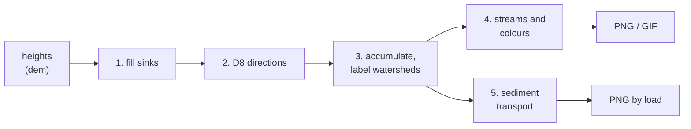

# Demo: stream delineation

Rain that falls on a landscape runs downhill, gathers in valleys and becomes
streams. *Stream delineation* recovers those streams from a terrain model:
given the height of every point on a grid, it works out where the water on
each cell goes, how much water passes through each cell, which cells carry
enough to be a stream, and which outlet each cell drains to (its watershed).
It is Pia's flagship demo
([ADR 0016](adr/0016-stream-delineation-flagship-demo.md)), and its second
half moves sediment down those streams, with the total mass proved to stay
the same exactly ([sediment.pia.md](sediment.pia.md)).

This page is the program. It is a literate Pia file,
[`docs/streams.pia.md`](https://github.com/deanberris/pia-lang/blob/main/docs/streams.pia.md):
the prose is Markdown, the fenced `pia` blocks are the code, and `piac`
reads the whole file, attaching each paragraph to the function after it
([ADR 0029](adr/0029-comments-as-syntax-and-literate-pia.md)). The build
proves every goal in it before it generates any code, so what you read here
is what was proved and what runs.

To run it on a Mac with Apple Silicon:

```console
$ bazel run //examples/streams
$ bazel run //examples/streams -- ~/Pictures/terrain.png ~/Desktop/streams.png
```

The first command draws a synthetic terrain, saves it as
`streams-input.png` in the current directory, and writes the result to
`streams-output.png`. It prints a text preview of the map and how long
each stage took; on an M-series iMac the whole 384x256 map takes about 30
ms. The second reads your own heightmap, in any format
macOS can open (PNG, GIF, JPEG, TIFF, BMP), where brighter means higher, and
writes the map as PNG, or GIF if the name ends in `.gif`. Use a 16-bit heightmap
where you can: an 8-bit one has only 256 levels, so its terraces become
flats, and filling slopes each flat gently towards its outlet, which the
map shows as lake.

Or run it on real terrain, an SRTM tile (see [Reading an SRTM
tile](#reading-an-srtm-tile)):

```console
$ examples/streams/fetch_srtm.sh /tmp/srtm
$ bazel run //examples/streams:srtm -- /tmp/srtm/N46E008.hgt ~/Desktop/alps.png
$ bazel run //examples/streams -- ~/Desktop/alps-quarter.png ~/Desktop/alps-map.png
```

The first command downloads the 1″ tile N46E008, in the Swiss Alps, and
checks it. The second runs the pipeline on all 13 million cells, timing
each stage. It writes the map, and a quarter-size view of the heights,
which the third command turns into the animation of the evolving
landscape.

## The pipeline



1. **Fill sinks.** Real elevation data has pits, cells lower than all their
   neighbours, where water would get stuck. Filling raises each pit to the
   level where it spills, so every cell has a way down to the edge.
2. **D8 flow directions.** Each cell sends its water to the one neighbour,
   of its eight, down the steepest slope.
3. **Flow accumulation.** Following the directions from every cell counts
   how many cells drain through each cell, and the cell where each path
   ends labels its watershed.
4. **Streams.** A cell is part of a stream when at least `threshold` cells
   drain through it. The last stage colours the map: streams in blue,
   filled pits as lakes, and every other cell by its watershed, shaded by
   height.
5. **Sediment.** Water carries sediment down the same paths, eroding where
   it can carry more and depositing where it carries too much, and the
   stream cells are coloured by the load they carry.

What the verifier proves, function by function, is summed up
[at the end](#what-is-proved). The headline results are three theorems
about the whole grid, each a postcondition with a `forall`:

- filling never lowers the ground, `fill.[k] >= dem.[k]` for every cell,
  and every cell that is not an outlet has a neighbour that is lower, or
  as high and closer to an outlet;
- every flow direction points strictly downhill, or nowhere;
- no cell's accumulation exceeds the number of cells, and every watershed
  label is an outlet;
- sediment transport conserves the total mass exactly:
  `sum bed + sum load + sum inflow + gone` never changes.

The second one is what makes the third possible: because water only ever
runs strictly downhill, the path from a cell must end, and it cannot visit a
cell twice.

## The grid

The heights arrive as a slice of `u16`, one per cell, stored row by row,
`w` cells to a row. So the cell above cell `m` is `m - w`, and the one below
is `m + w`. The first and last rows and columns are the *border*: water that
reaches a border cell leaves the map. Every loop over the grid visits the
*interior* the same way the [edge detector](demo.md) does: a row at a time,
starting at row offset `r = w`, and keeping one row on each side, so all
eight neighbours of an interior cell are in bounds.

The program never multiplies. A module that multiplies is encoded with much
wider bit-vectors, and loop proofs then time out
([issue #45](https://github.com/deanberris/pia-lang/issues/45)), so it adds
instead: row offsets grow by `w`, and `3 * i` is `i + i + i`.

The file is one module, `Streams` ([ADR 0039](adr/0039-module-and-interface-syntax.md)).
Its interface lists the nine functions the C program calls, with the
preconditions a caller must keep; everything else on this page is private
to the module:

```pia
module Streams : Delineation

interface Delineation @abi(c) = sig
  let load_hgt : (raw : [u8]) -> (dem : out mutable [u16]) -> usize
    requires len dem + len dem = len raw
  let fill_sinks : (dem : [u16]) -> (w : usize) -> (fill : out mutable [u16])
      -> (parent : out mutable [usize]) -> (rank : out mutable [usize])
      -> (next : out mutable [usize]) -> (head : out mutable [usize]) -> usize
    requires len fill = len dem && len parent = len dem && len rank = len dem
    requires len next = len dem && len head = 65536
    requires w >= 3 && w + w + w <= len dem && len dem < max u32
  let directions : (fill : [u16]) -> (w : usize)
      -> (down : out mutable [usize]) -> unit
    requires len down = len fill && w >= 3 && w + w + w <= len fill
  let accumulate : (fill : [u16]) -> (down : [usize])
      -> (acc : out mutable [u32]) -> (basin : out mutable [usize]) -> unit
    requires len down = len fill && len acc = len fill && len basin = len fill
    requires len fill < max u32
    requires forall (k in 0..len down).
               down.[k] = k || (down.[k] < len fill && fill.[down.[k]] < fill.[k])
  let render : (dem : [u16]) -> (fill : [u16]) -> (acc : [u32])
      -> (basin : [usize]) -> (threshold : u32) -> (rgb : out mutable [u8])
      -> usize
    requires len fill = len dem && len acc = len dem && len basin = len dem
    requires len rgb = len dem + len dem + len dem
  let delineate : (dem : [u16]) -> (w : usize) -> (threshold : u32)
      -> (fill : out mutable [u16]) -> (parent : out mutable [usize])
      -> (rank : out mutable [usize]) -> (next : out mutable [usize])
      -> (head : out mutable [usize])
      -> (down : out mutable [usize]) -> (acc : out mutable [u32])
      -> (basin : out mutable [usize]) -> (rgb : out mutable [u8]) -> usize
    requires w >= 3 && w + w + w <= len dem && len dem < max u32
    requires len fill = len dem && len down = len dem && len acc = len dem
    requires len basin = len dem && len rgb = len dem + len dem + len dem
    requires len parent = len dem && len rank = len dem && len next = len dem
    requires len head = 65536
  let palette : (pal : out mutable [u8]) -> unit
    requires len pal = 768
  let render_load_index : (dem : [u16]) -> (fill : [u16]) -> (acc : [u32])
      -> (basin : [usize]) -> (flux : [u32]) -> (threshold : u32)
      -> (idx : out mutable [u8]) -> unit
    requires len fill = len dem && len acc = len dem && len basin = len dem
    requires len flux = len dem && len idx = len dem
  let render_load : (dem : [u16]) -> (fill : [u16]) -> (acc : [u32])
      -> (basin : [usize]) -> (flux : [u32]) -> (threshold : u32)
      -> (rgb : out mutable [u8]) -> usize
    requires len fill = len dem && len acc = len dem && len basin = len dem
    requires len flux = len dem && len rgb = len dem + len dem + len dem
end
```

Heights are compared through a small helper whose postcondition says
exactly what it returns, so callers can reason about the result:

```pia
let higher (a : u16) (b : u16) : u16
  ensures result >= a && result >= b && (result = a || result = b)
= if a > b then a else b
```

The offset of the last interior row: the last row that has a row after it.
The loop walks down the rows; its measure is the distance to the end of the
slice, which shrinks by `w` each time.

```pia
let last_row (n : usize) (w : usize) : usize
  requires w >= 3 && w + w + w <= n
  ensures w <= result && result + w + w <= n
=
  let r : mutable usize = w in
  while w <= n - (r + w + w)
    invariant w <= r && r + w + w <= n
    decreases n - r
  do
    r <- r + w
  done;
  r
```

## Reading an SRTM tile

The heights can come from the Shuttle Radar Topography Mission. An SRTM
tile, a `.hgt` file, covers one degree of latitude and longitude. It holds
nothing but its heights, in metres, as big-endian `i16`, row by row from
the north-west corner. A 1″ tile is 3601 × 3601 cells, a 3″ tile 1201 ×
1201, and the size follows from the length of the file. Cells the radar
did not see hold -32768, a *void*.

Two bytes make one height. The high byte comes first, and a value of
32768 or more is negative.

```pia
let sample (hi : u8) (lo : u8) : i32
  ensures result >= min i16 && result <= max i16
= let h : i32 = hi in
  let l : i32 = lo in
  let u : i32 = ((h << 8) | l) in
  if u >= 32768 then u - 65536 else u
```

The width of a tile from its length in bytes: 3601 or 1201, or 256 for the
256 × 256 crops the tests use. Anything else is not a tile, and the result
is 0.

```pia
let hgt_side (bytes : usize) : usize
  ensures result = 0 || result = 256 || result = 1201 || result = 3601
=
  if bytes = 25'934'402 then 3601
  else if bytes = 2'884'802 then 1201
  else if bytes = 131'072 then 256
  else 0
```

`load_hgt` turns a tile into the `u16` heights the rest of the page uses,
and returns its width, or 0 if the bytes are not a tile. It shifts every
height up by the lowest one in the tile, so the lowest becomes 0. A tile
spans at most 65535 metres, so every height fits. A void becomes 0 as well,
a pit as deep as the lowest ground, and filling raises it to the level
where it spills. So a void ends up filled from its neighbours, by the
stage that fills every other pit, and the loader needs no rule of its
own.

The postcondition is what the next stage requires, whenever the result is
not 0: at least three rows of at least three cells. The `if d < 0` cannot
happen once `base` is the lowest height. The loop does not prove that, so
the clamp keeps the narrowing to `u16` safe without it.

```pia
let load_hgt (raw : [u8]) (dem : out mutable [u16]) : usize
  requires len dem + len dem = len raw
  ensures result = 0 || (result >= 3 && result + result + result <= len dem)
=
  let w = hgt_side (len raw) in
  let lowest : mutable i32 = max i16 in
  let b : mutable usize = 0 in
  for i in 0 .. len dem
    invariant b = i + i
    invariant lowest >= min i16 && lowest <= max i16
  do
    let v = sample (raw.[b]) (raw.[b + 1]) in
    if v <> min i16 && v < lowest then lowest <- v else ();
    b <- b + 2
  done;
  let base = lowest in
  b <- 0;
  for i in 0 .. len dem
    invariant b = i + i
  do
    let v = sample (raw.[b]) (raw.[b + 1]) in
    let d : i32 = if v = min i16 then 0 else v - base in
    dem.[i] <- if d < 0 then 0 else d;
    b <- b + 2
  done;
  w
```

## 1. Filling sinks

The method is *priority-flood* (Barnes, Lehman and Mulla,
[2014](https://doi.org/10.1016/j.cageo.2013.04.024)). Water enters the map
at the border, which is the edge of the world: every border cell is an
*outlet*, at its own height. The flood then grows inwards, always from the
lowest cell it has reached so far. Each cell it reaches for the first time
takes the height

```text
higher (dem.[nb]) (fill.[c] +| 1)
```

where `c` is the cell it came from. That is the ground if the ground
already sits above `c`. Otherwise it is one unit above `c`, so a pit fills
up to the point where it spills, plus one unit per cell back from that
point. Even a filled lake slopes gently towards its outlet, and the next
stage always finds a way down. The `+ 1` saturates at `max u16`, so heights
near the top of the range cannot overflow. A cell there may find no lower
neighbour, which the later stages handle.

Because the flood always grows from its lowest cell, the heights it gives
are the lowest that drain: the same surface as Planchon and Darboux's
iteration ([2001](https://doi.org/10.1016/S0341-8162(01)00164-3)), which
this page used before. That method sweeps the map until nothing changes,
which takes a few sweeps on a small map and hundreds on a real one.
Priority-flood visits each cell once. The C tests check the two against
each other.

The theorem is about the cell each cell was reached from, its `parent`,
and the order cells were reached in, their `rank`. Rank 0 means not
reached yet. A cell that is its own parent is an outlet. For every other
cell that has been reached:

- its parent is one of its eight neighbours;
- its parent was reached earlier, so it has a lower rank;
- its parent's height is at most its own.

Every cell also sits at or above the ground. So every cell that is not an
outlet has a neighbour that is lower, or as high and closer to an outlet.
Following parents from any cell, the rank falls at every step, so the
path ends, and it ends at an outlet. That is the invariant
[the design](design.md#stress-test-stream-delineation) asks of this
stage. With the `+ 1`, the parent is in fact strictly lower, until heights
reach `max u16`.

A neighbour is one of eight offsets away. The check is in `usize`, with no
overflow: `a` comes before `b` in the grid, one cell or about one row
apart.

```pia
let spec step_of (w : usize) (a : usize) (b : usize) : bool
  requires w >= 1 && w < max usize
= if a < b then (b - a = 1 || b - a = w - 1 || b - a = w || b - a = w + 1) else false

let spec adjacent (w : usize) (k : usize) (p : usize) : bool
  requires w >= 1 && w < max usize
= step_of w p k || step_of w k p
```

`drained` is the theorem, as four `forall`s. Each one is kept separate,
because Z3 instantiates small quantifiers more readily than one large one.

```pia
let spec drained (dem : [u16]) (fill : [u16]) (parent : [usize]) (rank : [usize]) (w : usize) : bool
  requires len fill = len dem && len parent = len dem && len rank = len dem
  requires w >= 1 && w < max usize
= (forall (k in 0 .. len dem). rank.[k] > 0 ==> fill.[k] >= dem.[k] && parent.[k] < len dem)
  && (forall (k in 0 .. len dem). rank.[k] > 0 && parent.[k] <> k ==> adjacent w k (parent.[k]))
  && (forall (k in 0 .. len dem). rank.[k] > 0 && parent.[k] <> k ==> rank.[parent.[k]] > 0 && rank.[parent.[k]] < rank.[k])
  && (forall (k in 0 .. len dem). rank.[k] > 0 && parent.[k] <> k ==> fill.[parent.[k]] <= fill.[k])
```

The flood's queue is a *bucket queue*: one list of cells for each of the
65536 heights, so taking the lowest cell is a walk up the buckets, and the
flood is linear in the number of cells. `head.[h]` is the first cell of
height `h`'s list and `next.[k]` the cell after `k`, with `len dem`
meaning the end of a list. `queued` says every link is a cell or the end,
which is all the indexing needs.

```pia
let spec queued (next : [usize]) (head : [usize]) : bool
  requires len head = 65536
= (forall (k in 0 .. len next). next.[k] <= len next)
  && (forall (j in 0 .. 65536). head.[j] <= len next)
```

Reaches `nb` from `c`: its height, its parent and its rank. The ensures
keeps the theorem. Every other cell keeps its rank, which the callers need
to know that `c` is still reached afterwards.

```pia
let settle_cell (dem : [u16]) (w : usize) (c : usize) (nb : usize) (r : usize)
    (fill : inout mutable [u16]) (parent : inout mutable [usize])
    (rank : inout mutable [usize]) : u16
  requires len fill = len dem && len parent = len dem && len rank = len dem
  requires w >= 1 && w < max usize
  requires c < len dem && nb < len dem && rank.[c] > 0 && rank.[nb] = 0
  requires adjacent w nb c && rank.[c] < r
  requires drained dem fill parent rank w
  ensures drained dem fill parent rank w
  ensures forall (k in 0 .. len dem). k = nb || rank.[k] = old (rank.[k])
  ensures rank.[nb] = r && result = fill.[nb]
=
  let v = higher (dem.[nb]) (fill.[c] +| 1) in
  fill.[nb] <- v;
  parent.[nb] <- c;
  rank.[nb] <- r;
  v
```

Puts `nb` at the front of the list for height `v`.

```pia
let push (nb : usize) (v : u16) (next : inout mutable [usize]) (head : inout mutable [usize]) : unit
  requires nb < len next && len head = 65536
  requires queued next head
  ensures queued next head
=
  next.[nb] <- head.[v];
  head.[v] <- nb
```

Looks at `nb` from `c`. A cell not reached yet is reached and queued. Every
rank is below `count`, which grows by one each time, so a new cell's rank
is above its parent's. If `count` ever reached `max usize`, which would
take more cells than any machine has memory for, the cell would be left
for the last pass to make an outlet.

```pia
let visit (dem : [u16]) (w : usize) (c : usize) (nb : usize)
    (fill : inout mutable [u16]) (parent : inout mutable [usize])
    (rank : inout mutable [usize]) (next : inout mutable [usize])
    (head : inout mutable [usize]) (count : inout mutable usize) : unit
  requires len fill = len dem && len parent = len dem && len rank = len dem
  requires len next = len dem && len head = 65536
  requires w >= 1 && w < max usize
  requires c < len dem && nb < len dem && rank.[c] > 0 && adjacent w nb c
  requires forall (k in 0 .. len dem). rank.[k] < count
  requires drained dem fill parent rank w && queued next head
  ensures forall (k in 0 .. len dem). rank.[k] < count
  ensures drained dem fill parent rank w && queued next head
  ensures rank.[c] > 0 && count >= old count
=
  if rank.[nb] = 0 && count < max usize then (
    let v = settle_cell dem w c nb count fill parent rank in
    push nb v next head;
    count <- count + 1
  ) else ()
```

The neighbour `d` cells before or after `c`, or `n` if that is off the
slice. The `assert`s name the step for the solver, which then proves the
postcondition at once.

```pia
let before (n : usize) (w : usize) (c : usize) (d : usize) : usize
  requires w >= 3 && w < max usize && c < n && (d = 1 || d = w - 1 || d = w || d = w + 1)
  ensures result = n || (result < n && adjacent w result c)
= if c >= d then (
    let nb = c - d in
    assert c - nb = d;
    assert step_of w nb c;
    nb
  ) else n

let after (n : usize) (w : usize) (c : usize) (d : usize) : usize
  requires w >= 3 && w < max usize && c < n && (d = 1 || d = w - 1 || d = w || d = w + 1)
  ensures result = n || (result < n && adjacent w result c)
= if d < n - c then (
    let nb = c + d in
    assert nb - c = d;
    assert step_of w c nb;
    nb
  ) else n
```

The eight neighbours, numbered in row order. A border cell's offsets can
wrap around to the other side of the map. Those cells are on the border
too, and every border cell is an outlet before the flood starts, so the
flood never reaches one through a wrap.

```pia
let neighbour (n : usize) (w : usize) (c : usize) (d : int{0..7}) : usize
  requires w >= 3 && w < max usize && c < n
  ensures result = n || (result < n && adjacent w result c)
=
  if d = 0 then before n w c (w + 1)
  else if d = 1 then before n w c w
  else if d = 2 then before n w c (w - 1)
  else if d = 3 then before n w c 1
  else if d = 4 then after n w c 1
  else if d = 5 then after n w c (w - 1)
  else if d = 6 then after n w c w
  else after n w c (w + 1)
```

Looks at all eight neighbours of `c`.

```pia
let expand (dem : [u16]) (w : usize) (c : usize)
    (fill : inout mutable [u16]) (parent : inout mutable [usize])
    (rank : inout mutable [usize]) (next : inout mutable [usize])
    (head : inout mutable [usize]) (count : inout mutable usize) : unit
  requires len fill = len dem && len parent = len dem && len rank = len dem
  requires len next = len dem && len head = 65536
  requires w >= 3 && w < max usize
  requires c < len dem && rank.[c] > 0
  requires forall (k in 0 .. len dem). rank.[k] < count
  requires drained dem fill parent rank w && queued next head
  ensures forall (k in 0 .. len dem). rank.[k] < count
  ensures drained dem fill parent rank w && queued next head
  ensures count >= old count
=
  for d in 0 .. 8
    invariant forall (k in 0 .. len dem). rank.[k] < count
    invariant drained dem fill parent rank w && queued next head
    invariant rank.[c] > 0 && count >= old count
  do
    let nb = neighbour (len dem) w c d in
    if nb < len dem then visit dem w c nb fill parent rank next head count else ()
  done
```

Makes `k` an outlet at its own height, rank 1, and queues it, unless it
has been reached already. The result says whether it was new.

```pia
let seed (dem : [u16]) (w : usize) (k : usize)
    (fill : inout mutable [u16]) (parent : inout mutable [usize])
    (rank : inout mutable [usize]) (next : inout mutable [usize])
    (head : inout mutable [usize]) (count : usize) : bool
  requires len fill = len dem && len parent = len dem && len rank = len dem
  requires len next = len dem && len head = 65536
  requires w >= 3 && w < max usize && k < len dem && count >= 2
  requires forall (j in 0 .. len dem). rank.[j] < count
  requires drained dem fill parent rank w && queued next head
  ensures forall (j in 0 .. len dem). rank.[j] < count
  ensures drained dem fill parent rank w && queued next head
  ensures rank.[k] > 0
  ensures forall (j in 0 .. len dem). j = k || rank.[j] = old (rank.[j])
=
  if rank.[k] = 0 then (
    fill.[k] <- dem.[k];
    parent.[k] <- k;
    rank.[k] <- 1;
    push k (dem.[k]) next head;
    true
  ) else false
```

Takes the first cell off the list for `level`, or returns `len next` if
the list is empty.

```pia
let pop (level : u16) (next : [usize]) (head : inout mutable [usize]) : usize
  requires len head = 65536 && queued next head
  ensures queued next head && result <= len next
=
  let c = head.[level] in
  if c < len next then (head.[level] <- next.[c]; c) else len next
```

The start: every cell unreached, every list empty. With no cell reached,
`drained` holds trivially.

```pia
let clear_flood (dem : [u16]) (w : usize)
    (fill : out mutable [u16]) (parent : out mutable [usize])
    (rank : out mutable [usize]) (next : out mutable [usize])
    (head : out mutable [usize]) : unit
  requires len fill = len dem && len parent = len dem && len rank = len dem
  requires len next = len dem && len head = 65536
  requires w >= 3 && w < max usize
  ensures forall (k in 0 .. len dem). rank.[k] = 0
  ensures queued next head
  ensures drained dem fill parent rank w
=
  let n = len dem in
  for k in 0 .. n
    invariant forall (j in 0 .. k). rank.[j] = 0 && next.[j] <= n
  do
    fill.[k] <- dem.[k];
    parent.[k] <- k;
    rank.[k] <- 0;
    next.[k] <- n
  done;
  for j in 0 .. 65536
    invariant forall (i in 0 .. j). head.[i] <= n
  do
    head.[j] <- n
  done
```

The border's outlets: the first and last rows, then both ends of every row
between.

```pia
let seed_border (dem : [u16]) (w : usize)
    (fill : inout mutable [u16]) (parent : inout mutable [usize])
    (rank : inout mutable [usize]) (next : inout mutable [usize])
    (head : inout mutable [usize]) (count : usize) : unit
  requires len fill = len dem && len parent = len dem && len rank = len dem
  requires len next = len dem && len head = 65536
  requires w >= 3 && w + w + w <= len dem && count >= 2
  requires forall (j in 0 .. len dem). rank.[j] < count
  requires drained dem fill parent rank w && queued next head
  ensures forall (j in 0 .. len dem). rank.[j] < count
  ensures drained dem fill parent rank w && queued next head
=
  let n = len dem in
  for k in 0 .. w
    invariant forall (j in 0 .. n). rank.[j] < count
    invariant drained dem fill parent rank w && queued next head
  do
    let s0 = seed dem w k fill parent rank next head count in ()
  done;
  for k in n - w .. n
    invariant forall (j in 0 .. n). rank.[j] < count
    invariant drained dem fill parent rank w && queued next head
  do
    let s1 = seed dem w k fill parent rank next head count in ()
  done;
  let r : mutable usize = w in
  while r < n - w
    invariant w <= r
    invariant forall (j in 0 .. n). rank.[j] < count
    invariant drained dem fill parent rank w && queued next head
    decreases n - r
  do
    let s2 = seed dem w r fill parent rank next head count in
    let s3 = seed dem w (r + w - 1) fill parent rank next head count in
    r <- r + w
  done
```

Empties the bucket for one height. A cell reached from this level lands
in a higher bucket, or in this one at `max u16`. The measure counts the
cells taken, at most `len dem` per level. A list could only be longer if it
had a cycle, which it cannot, but the loop does not need to know that.

```pia
let drain_level (dem : [u16]) (w : usize) (level : u16)
    (fill : inout mutable [u16]) (parent : inout mutable [usize])
    (rank : inout mutable [usize]) (next : inout mutable [usize])
    (head : inout mutable [usize]) (count : inout mutable usize) : unit
  requires len fill = len dem && len parent = len dem && len rank = len dem
  requires len next = len dem && len head = 65536
  requires w >= 3 && w < max usize
  requires forall (j in 0 .. len dem). rank.[j] < count
  requires drained dem fill parent rank w && queued next head
  ensures forall (j in 0 .. len dem). rank.[j] < count
  ensures drained dem fill parent rank w && queued next head
  ensures count >= old count
=
  let n = len dem in
  let pops : mutable usize = 0 in
  let more : mutable bool = true in
  while more && pops < n
    invariant pops <= n && count >= old count
    invariant forall (j in 0 .. n). rank.[j] < count
    invariant drained dem fill parent rank w && queued next head
    decreases n - pops
  do
    let c = pop level next head in
    pops <- pops + 1;
    if c = n then more <- false
    else if rank.[c] > 0 then expand dem w c fill parent rank next head count
    else ()
  done
```

After the flood, any cell still unreached becomes an outlet of its own.
On a grid every cell is reached from the border, so this finds none. The
result counts them, and the tests check that it is 0. This last pass is
what lets the postcondition say that *every* cell has been reached, with
no proof that the flood itself gets everywhere.

```pia
let finish (dem : [u16]) (w : usize)
    (fill : inout mutable [u16]) (parent : inout mutable [usize])
    (rank : inout mutable [usize]) (next : inout mutable [usize])
    (head : inout mutable [usize]) (count : usize) : usize
  requires len fill = len dem && len parent = len dem && len rank = len dem
  requires len next = len dem && len head = 65536
  requires w >= 3 && w < max usize && count >= 2
  requires forall (j in 0 .. len dem). rank.[j] < count
  requires drained dem fill parent rank w && queued next head
  ensures drained dem fill parent rank w
  ensures forall (k in 0 .. len dem). rank.[k] > 0
  ensures result <= len dem
=
  let extra : mutable usize = 0 in
  for k in 0 .. len dem
    invariant extra <= k
    invariant forall (j in 0 .. k). rank.[j] > 0
    invariant forall (j in 0 .. len dem). rank.[j] < count
    invariant drained dem fill parent rank w && queued next head
  do
    if seed dem w k fill parent rank next head count then extra <- extra + 1 else ()
  done;
  extra
```

The whole stage. The caller passes the scratch buffers, since Pia cannot
allocate yet. The `ensures` is the theorem for every cell of the map.

```pia
let fill_sinks (dem : [u16]) (w : usize)
    (fill : out mutable [u16]) (parent : out mutable [usize])
    (rank : out mutable [usize]) (next : out mutable [usize])
    (head : out mutable [usize]) : usize
  requires len fill = len dem && len parent = len dem && len rank = len dem
  requires len next = len dem && len head = 65536
  requires w >= 3 && w + w + w <= len dem && len dem < max u32
  ensures drained dem fill parent rank w
  ensures forall (k in 0 .. len dem). rank.[k] > 0
  ensures result <= len dem
=
  clear_flood dem w fill parent rank next head;
  let count : mutable usize = 2 in
  seed_border dem w fill parent rank next head count;
  for level in 0 .. 65536
    invariant count >= 2
    invariant forall (j in 0 .. len dem). rank.[j] < count
    invariant drained dem fill parent rank w && queued next head
  do
    drain_level dem w level fill parent rank next head count
  done;
  finish dem w fill parent rank next head count
```

## 2. D8 flow directions

D8 sends all the water on a cell to one of its eight neighbours, the one
down the steepest slope. A diagonal neighbour is √2 times as far away as
one beside or above, so its drop counts for less: drops are weighted by 10
for the four near neighbours and by 7 for the diagonals, since 10/√2 is
7.07. A cell with no lower neighbour, such as an outlet on the border,
points at itself.

The direction of a cell is stored as the index of the cell it drains to, in
a slice `down`. The property that matters downstream is that every
direction points *strictly downhill*:

```text
down.[k] = k || (down.[k] < len fill && fill.[down.[k]] < fill.[k])
```

The verifier proves this for every cell, starting with one candidate at a
time. A `route` is the best neighbour found so far, with its weighted drop.

```pia
let route = type { target : usize; drop : u32 }
```

Ten times a drop, by addition.

```pia
let tenfold (d : u16) : u32 =
  let d2 : u32 = d + d in
  let d4 : u32 = d2 + d2 in
  d4 + d4 + d2
```

Seven times a drop.

```pia
let sevenfold (d : u16) : u32 =
  let d2 : u32 = d + d in
  let d4 : u32 = d2 + d2 in
  d4 + d2 + d
```

Considers neighbour `n` of cell `m` against the best route so far. A
neighbour wins only if it is lower than `m` and its weighted drop beats the
best, so ties go to the first neighbour considered. Whatever happens, the
route still points at `m` itself or strictly downhill: the precondition
says so of `best`, and the postcondition of the result.

```pia
let consider (fill : [u16]) (m : usize) (n : usize) (diagonal : bool)
    (best : route) : route
  requires m < len fill && n < len fill
  requires best.target = m
           || (best.target < len fill && fill.[best.target] < fill.[m])
  ensures result.target = m
          || (result.target < len fill && fill.[result.target] < fill.[m])
=
  if fill.[n] < fill.[m] then
    (let d : u16 = fill.[m] - fill.[n] in
     let slope : u32 = if diagonal then sevenfold d else tenfold d in
     if slope > best.drop then { target = n; drop = slope } else best)
  else best
```

The D8 direction of interior cell `m`: the eight neighbours, row by row.

```pia
let steepest (fill : [u16]) (w : usize) (r : usize) (m : usize) : usize
  requires w <= r && r + w + w <= len fill && r < m && m + 1 < r + w
  ensures result = m || (result < len fill && fill.[result] < fill.[m])
=
  assert w < m && m + w + 1 < len fill;
  let a = m - w in
  let b = m + w in
  let none : route = { target = m; drop = 0 } in
  let r1 = consider fill m (a - 1) true none in
  let r2 = consider fill m a false r1 in
  let r3 = consider fill m (a + 1) true r2 in
  let r4 = consider fill m (m - 1) false r3 in
  let r5 = consider fill m (m + 1) false r4 in
  let r6 = consider fill m (b - 1) true r5 in
  let r7 = consider fill m b false r6 in
  let r8 = consider fill m (b + 1) true r7 in
  r8.target
```

The directions of the interior of the row that starts at `r`. The loop
invariant is the downhill property for the whole slice: writing one cell's
direction keeps it, because `steepest` guarantees it for that cell.

```pia
let directions_row (fill : [u16]) (w : usize) (r : usize)
    (down : inout mutable [usize]) : unit
  requires len down = len fill && w >= 3 && w <= r && r + w + w <= len fill
  requires forall (k in 0..len down).
             down.[k] = k || (down.[k] < len fill && fill.[down.[k]] < fill.[k])
  ensures forall (k in 0..len down).
            down.[k] = k || (down.[k] < len fill && fill.[down.[k]] < fill.[k])
=
  for m in r + 1..r + w - 1
    invariant forall (k in 0..len down).
                down.[k] = k || (down.[k] < len fill && fill.[down.[k]] < fill.[k])
  do
    down.[m] <- steepest fill w r m
  done
```

The whole stage. Every cell starts pointing at itself, which is trivially
"downhill or nowhere", so border cells are outlets; then each interior row
gets its directions. The row loop counts up to the last interior row
rather than testing for room below, as the others do: with the downhill
`forall` in its invariant, the solver could not see the subtraction in that
test was safe within its timeout
([issue #96](https://github.com/deanberris/pia-lang/issues/96)), and
comparisons with `last` need no subtraction. The postcondition is the second theorem. Unlike
filling, each cell's direction depends only on `fill`, so the rows are
independent; once `spread` is compiled
([M12](https://github.com/deanberris/pia-lang/issues/13)) they can run in
parallel.

```pia
let directions (fill : [u16]) (w : usize) (down : out mutable [usize]) : unit
  requires len down = len fill && w >= 3 && w + w + w <= len fill
  ensures forall (k in 0..len down).
            down.[k] = k || (down.[k] < len fill && fill.[down.[k]] < fill.[k])
=
  for i in 0..len down
    invariant forall (k in 0..i). down.[k] = k
  do
    down.[i] <- i
  done;
  let last = last_row (len fill) w in
  let r : mutable usize = w in
  while r <= last
    invariant w <= r && r <= last + w && last + w + w <= len fill
    invariant forall (k in 0..len down).
                down.[k] = k || (down.[k] < len fill && fill.[down.[k]] < fill.[k])
    decreases last + w - r
  do
    directions_row fill w r down;
    r <- r + w
  done
```

## 3. Flow accumulation and watersheds

The flow accumulation of a cell is the number of cells whose water passes
through it, itself included. One way to count it is to start a drop of
water on every cell in turn, follow the directions until it reaches an
outlet, and add one to every cell on the way. The outlet where the drop
ends is the cell's watershed label.

`walk` follows one drop from `start`. Two things about it are proved here
that a C programmer would only argue in a comment.

**It ends.** The loop's measure is the height of the current cell,
`fill.[cur]`. The downhill theorem says each step goes to a strictly lower
cell, so the measure falls every iteration, and a `u16` cannot fall
forever.

**It counts every cell at most once.** Before the walk, no count exceeds
`bound`. The invariant splits the grid by height: cells strictly below the
drop have not been visited yet, so their counts are still at most `bound`,
and every count is at most `bound + 1`. Stepping down to the next cell, it
is below the drop, so its count goes from at most `bound` to at most
`bound + 1`, and the cells below *it* are still below the drop. That is why
the `+ 1` cannot overflow, with no saturation and no run-time check.

```pia
let walk (fill : [u16]) (down : [usize]) (start : usize) (bound : u32)
    (acc : inout mutable [u32]) : usize
  requires len down = len fill && len acc = len fill && start < len fill
  requires bound < max u32
  requires forall (k in 0..len down).
             down.[k] = k || (down.[k] < len fill && fill.[down.[k]] < fill.[k])
  requires forall (k in 0..len acc). acc.[k] <= bound
  ensures result < len fill && down.[result] = result
  ensures forall (k in 0..len acc). acc.[k] <= bound + 1
=
  acc.[start] <- acc.[start] + 1;
  let cur : mutable usize = start in
  while down.[cur] <> cur
    invariant cur < len fill
    invariant forall (k in 0..len acc).
                (fill.[k] < fill.[cur] ==> acc.[k] <= bound) && acc.[k] <= bound + 1
    decreases fill.[cur]
  do
    cur <- down.[cur];
    acc.[cur] <- acc.[cur] + 1
  done;
  cur
```

The whole stage: a walk from every cell. After `s` walks no count exceeds
`s`, so at the end none exceeds the number of cells; and every label
written so far is an outlet, a cell that points at itself. These are the
third theorem. The precondition on `len fill` keeps the counts within
`u32`. Its downhill precondition is exactly the postcondition of
`directions`, which is how the stages compose: each is proved against the
contract of the one before, not its code.

The cost is the total length of all the paths, which is fine for maps of a
few million cells. A faster method visits each cell once in topological
order, but needs a queue the size of the map, and Pia cannot allocate one
yet ([issue #86](https://github.com/deanberris/pia-lang/issues/86)).

```pia
let accumulate (fill : [u16]) (down : [usize]) (acc : out mutable [u32])
    (basin : out mutable [usize]) : unit
  requires len down = len fill && len acc = len fill && len basin = len fill
  requires len fill < max u32
  requires forall (k in 0..len down).
             down.[k] = k || (down.[k] < len fill && fill.[down.[k]] < fill.[k])
  ensures forall (k in 0..len acc). acc.[k] <= len fill
  ensures forall (k in 0..len basin).
            basin.[k] < len fill && down.[basin.[k]] = basin.[k]
=
  for i in 0..len acc
    invariant forall (k in 0..i). acc.[k] = 0
  do
    acc.[i] <- 0
  done;
  for s in 0..len fill
    invariant forall (k in 0..len acc). acc.[k] <= s
    invariant forall (k in 0..s).
                basin.[k] < len fill && down.[basin.[k]] = basin.[k]
  do
    basin.[s] <- walk fill down s s acc
  done
```

## 4. Streams and the picture

A cell is on a stream when at least `threshold` cells drain through it.
The picture shows streams in blue, darker where the flow is at least 16
times the threshold; cells that filling raised, the lakes, in pale blue;
and everything else in its watershed's colour, darker where it is lower.
Neighbouring watersheds can share one of the six colours, since the palette
cycles by outlet index.

```pia
let colour = type { red : u8; green : u8; blue : u8 }
```

The colour of watershed `outlet`.

```pia
let tint (outlet : usize) : colour =
  let k = outlet mod 6 in
  if k = 0 then { red = 214; green = 168; blue = 110 }
  else if k = 1 then { red = 150; green = 190; blue = 110 }
  else if k = 2 then { red = 200; green = 140; blue = 160 }
  else if k = 3 then { red = 120; green = 170; blue = 160 }
  else if k = 4 then { red = 210; green = 200; blue = 120 }
  else { red = 170; green = 150; blue = 200 }
```

Whether flow `a` is at least sixteen times `threshold`, in `u64` so the
product cannot overflow.

```pia
let major (a : u32) (threshold : u32) : bool =
  let t2 : u64 = threshold + threshold in
  let t4 : u64 = t2 + t2 in
  let t8 : u64 = t4 + t4 in
  a >= t8 + t8
```

The colour of one cell: its height `h` before and `f` after filling, its
flow `a`, and its watershed. A height is 0 to `max u16`, so `h / 256` is a
byte, and the average of a byte and a byte is a byte: the verifier proves
both narrowings.

```pia
let paint (h : u16) (f : u16) (a : u32) (outlet : usize) (threshold : u32)
    : colour =
  if a >= threshold then
    (if major a threshold then { red = 20; green = 70; blue = 190 }
     else { red = 70; green = 140; blue = 240 })
  else if f > h then { red = 150; green = 205; blue = 235 }
  else
    (let t = tint outlet in
     let shade : u16 = h / 256 in
     let r : u16 = t.red + shade in
     let g : u16 = t.green + shade in
     let b : u16 = t.blue + shade in
     { red = r / 2; green = g / 2; blue = b / 2 })
```

The picture, as packed RGB bytes, and the number of stream cells, which
the invariant bounds by the number of cells painted.

```pia
let render (dem : [u16]) (fill : [u16]) (acc : [u32]) (basin : [usize])
    (threshold : u32) (rgb : out mutable [u8]) : usize
  requires len fill = len dem && len acc = len dem && len basin = len dem
  requires len rgb = len dem + len dem + len dem
  ensures result <= len dem
=
  let streams : mutable usize = 0 in
  for i in 0..len dem
    invariant streams <= i
  do
    let c = paint (dem.[i]) (fill.[i]) (acc.[i]) (basin.[i]) threshold in
    let j = i + i + i in
    rgb.[j] <- c.red;
    rgb.[j + 1] <- c.green;
    rgb.[j + 2] <- c.blue;
    streams <- streams + (if acc.[i] >= threshold then 1 else 0)
  done;
  streams
```

## The whole pipeline

`delineate` runs the four stages and returns the number of stream cells.
Each call's precondition is proved from the caller's own and from the
postconditions of the calls before it; in particular `accumulate` needs
the downhill theorem, which only `directions` provides. Swap the two calls
and the program no longer compiles.

```pia
let delineate (dem : [u16]) (w : usize) (threshold : u32)
    (fill : out mutable [u16]) (parent : out mutable [usize])
    (rank : out mutable [usize]) (next : out mutable [usize])
    (head : out mutable [usize]) (down : out mutable [usize])
    (acc : out mutable [u32]) (basin : out mutable [usize])
    (rgb : out mutable [u8]) : usize
  requires w >= 3 && w + w + w <= len dem && len dem < max u32
  requires len fill = len dem && len down = len dem && len acc = len dem
  requires len basin = len dem && len rgb = len dem + len dem + len dem
  requires len parent = len dem && len rank = len dem && len next = len dem
  requires len head = 65536
  ensures result <= len dem
=
  let outlets = fill_sinks dem w fill parent rank next head in
  directions fill w down;
  accumulate fill down acc basin;
  render dem fill acc basin threshold rgb
```

## 5. Sediment transport

The second half of the demo moves sediment down the streams, and is its
own page and module, [sediment.pia.md](sediment.pia.md), so the two prove
in parallel. Its entry point takes the filled heights, the directions and
the accumulation from this page, and returns `flux`, the load leaving each
cell. This page draws it.

The colour of a stream cell by the load leaving it: a ramp over the binary
logarithm of the load, from blue for 63 units or fewer to orange for 8192
or more, in eight steps. `clz` counts the leading zeros, so 32 - clz f is
the number of bits in f, with no logarithm and no multiplication.

```pia
let load_colour (f : u32) : colour =
  let lz : u32 = clz f in
  let l : u32 = 32 - lz in
  let m : u32 = if l < 6 then 0 else if l > 13 then 7 else l - 6 in
  { red = 31 + (m << 5); green = 60 + (m << 4); blue = 230 - (m << 5) }
```

The picture after transport: stream cells coloured by their load, every
other cell as in `render`.

```pia
let render_load (dem : [u16]) (fill : [u16]) (acc : [u32]) (basin : [usize])
    (flux : [u32]) (threshold : u32) (rgb : out mutable [u8]) : usize
  requires len fill = len dem && len acc = len dem && len basin = len dem
  requires len flux = len dem && len rgb = len dem + len dem + len dem
  ensures result <= len dem
=
  let streams : mutable usize = 0 in
  for i in 0..len dem
    invariant streams <= i
  do
    let c = (if acc.[i] >= threshold then load_colour (flux.[i])
             else paint (dem.[i]) (fill.[i]) (acc.[i]) (basin.[i]) threshold) in
    let j = i + i + i in
    rgb.[j] <- c.red;
    rgb.[j + 1] <- c.green;
    rgb.[j + 2] <- c.blue;
    streams <- streams + (if acc.[i] >= threshold then 1 else 0)
  done;
  streams
```

## 6. The animation's palette

An animated GIF has one palette for all its frames, so for the evolution's
animation each cell becomes an index into one fixed palette rather than a
colour. `load_step` is the step of the load ramp, as in `load_colour`.

```pia
let load_step (f : u32) : int{0..7} =
  let lz : u32 = clz f in
  let l : u32 = 32 - lz in
  if l < 6 then 0 else if l > 13 then 7 else l - 6
```

The palette index of one cell: the eight steps of the load ramp for
streams, then the lake colour, then the six watershed tints in 32 shades of
height each, 201 colours in all. `outlet mod 6` and `h >> 11` are both
small, so the index is proved to be below 201 by its type.

```pia
let index_of (h : u16) (f : u16) (a : u32) (outlet : usize) (flux : u32)
    (threshold : u32) : int{0..200} =
  if a >= threshold then load_step flux
  else if f > h then 8
  else
    (let k : int{0..5} = outlet mod 6 in
     let s : int{0..31} = h >> 11 in
     9 + (k << 5) + s)
```

The colour of each index: the ramp and the lake as above, and a watershed
shade as `paint` mixes it, with the height taken at the middle of its
shade. Indices from 201 up are unused and black.

```pia
let index_colour (i : u8) : colour =
  if i < 8 then
    (let m : u8 = i in
     { red = 31 + (m << 5); green = 60 + (m << 4); blue = 230 - (m << 5) })
  else if i = 8 then { red = 150; green = 205; blue = 235 }
  else if i < 201 then
    (let j : u8 = i - 9 in
     let t = tint (j >> 5) in
     let shade : u16 = ((j & 31) << 3) + 4 in
     let r : u16 = t.red + shade in
     let g : u16 = t.green + shade in
     let b : u16 = t.blue + shade in
     { red = r / 2; green = g / 2; blue = b / 2 })
  else { red = 0; green = 0; blue = 0 }
```

The shared palette: 256 colours, three bytes each.

```pia
let palette (pal : out mutable [u8]) : unit
  requires len pal = 768
= for i in 0..256 do
    let c = index_colour i in
    let j = i + i + i in
    pal.[j] <- c.red;
    pal.[j + 1] <- c.green;
    pal.[j + 2] <- c.blue
  done
```

One frame of the animation: every cell's palette index, each proved to
name one of the 201 colours `palette` fills.

```pia
let render_load_index (dem : [u16]) (fill : [u16]) (acc : [u32]) (basin : [usize])
    (flux : [u32]) (threshold : u32) (idx : out mutable [u8]) : unit
  requires len fill = len dem && len acc = len dem && len basin = len dem
  requires len flux = len dem && len idx = len dem
  ensures forall (k in 0..len idx). idx.[k] < 201
=
  for i in 0..len dem
    invariant forall (k in 0..i). idx.[k] < 201
  do
    idx.[i] <- index_of (dem.[i]) (fill.[i]) (acc.[i]) (basin.[i]) (flux.[i]) threshold
  done
```

## Why the order matters

Here is the walk without the downhill precondition. Nothing then stops
`down` from containing a cycle, so the loop might never end, and the
verifier says so: the measure is not proved to decrease, and `piac`
refuses to compile it.

<!-- example: walk_unproved.pia -->
<!-- expect: fail -->
```ocaml
let walk (fill : [u16]) (down : [usize]) (start : usize) : usize
  requires len down = len fill && start < len fill
  requires forall (k in 0..len down). down.[k] < len fill
=
  let cur : mutable usize = start in
  while down.[cur] <> cur
    invariant cur < len fill
    decreases fill.[cur]
  do
    cur <- down.[cur]
  done;
  cur
```

```console
$ piac --verify walk_unproved.pia
...
walk_unproved.pia:8:5: failed: the measure decreases
...
```

## What is proved

Every goal in this file is proved, by interval analysis or by Z3, before
`piac` generates code:

| Goal | Where |
| --- | --- |
| Every slice index is in bounds | every function |
| No arithmetic overflows, and every narrowing fits | every function; `walk`'s `+ 1` by its invariant |
| Every loop ends | `for` loops always; `while` loops by `decreases`; `walk` by the height of the drop |
| An SRTM tile's heights fit in `u16`, and a tile is at least 3 × 3 | `sample`, `load_hgt` |
| Filling never lowers the ground | `settle_cell` up to `fill_sinks` |
| Every cell drains: its parent is a neighbour, reached earlier, and no higher | `settle_cell` up to `fill_sinks` (`drained`) |
| Every direction points strictly downhill or nowhere | `consider` up to `directions` |
| Accumulation never exceeds the number of cells | `walk`, `accumulate` |
| Every watershed label is an outlet | `walk`, `accumulate` |
| The number of stream cells is at most the number of cells | `render`, `render_load` |
| Every animation frame's index names one of the palette's 201 colours | `index_of`, `render_load_index` |

What is *not* proved yet: that the flood reaches every cell from the
border, so that `fill_sinks` returns 0 (the tests check that it does), that
its surface is the lowest that drains, and that the D8 choice is the
steepest, rather than just downhill. None of these affect safety or termination.

## What is missing

The demo works around parts of Pia that are not built yet:

- **Image I/O.** Pia has no I/O, so [`main.c`](https://github.com/deanberris/pia-lang/blob/main/examples/streams/main.c)
  reads and writes images with macOS's ImageIO and hands Pia the heights.
  PNG and GIF codecs written in Pia are
  [M13](https://github.com/deanberris/pia-lang/issues/14), on top of the
  minimal core ([ADR 0023](adr/0023-minimal-core-self-hosted-stdlib.md)).
- **Allocation.** The caller passes every buffer. With the memory module
  ([issue #86](https://github.com/deanberris/pia-lang/issues/86)),
  `delineate` could allocate its own and use a queue for a linear-time
  accumulation.
- **Multiplication in loops** makes proofs time out
  ([issue #45](https://github.com/deanberris/pia-lang/issues/45)), so the
  code adds instead, and the slope weights are `tenfold` and `sevenfold`.
- **Floats** ([M11](https://github.com/deanberris/pia-lang/issues/12))
  would give true slopes in place of the 10:7 weights.
- **Vectorisation and parallelism.** Today LLVM vectorises only the
  simple loops: the copies in `clear_flood` and `down.[i] <- i` in
  `directions` become NEON loads, stores and adds. The stencil kernels
  (`settle`, `steepest`) and the walks are scalar. `steepest` and `paint`
  are branch-free enough to vectorise once proved facts drive it
  ([M10](https://github.com/deanberris/pia-lang/issues/11)), and
  `directions` and `render` are independent per row and per cell, so
  `spread` ([M12](https://github.com/deanberris/pia-lang/issues/13)) can
  run them across cores. Priority-flood fills in height order, so it stays
  sequential.
- **Solver robustness.** Goals beside a `forall` are slow for the solver,
  and some slices' element ranges are lost inside quantifiers
  ([issue #96](https://github.com/deanberris/pia-lang/issues/96)); the
  code is shaped around both, as noted where it matters.
